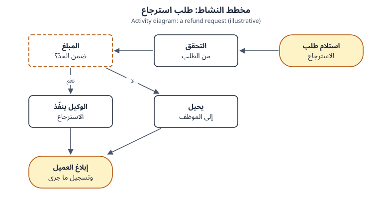

# مخطط النشاط · Activity Diagram

**النوع:** أداة أو قالب · **المستوى:** تطبيقي · **المجال:** تحليل المتطلبات وتصميم الأنظمة · **المنشأ:** معروف عالمياً · **المرحلة:** اكتشاف الفرصة، بناء الوكيل

## الغرض

أن ترسم ما يجري فعلاً، بشروطه وتفرعاته. مخطط النشاط من مخططات UML السلوكية، يبيّن تدفق التحكم أو تدفق الكائنات مع العناية بالتسلسل وشروطه: الفعل يبدأ حين ينتهي فعل قبله، أو حين تتوفر بيانات، أو حين يقع حدث. وعلى السهم شرط بين قوسين مربعين لا يُعبر إلا إذا تحقق، وتُجمع الأفعال في أقسام (مسارات) بحسب من يؤديها ([A235](../../SOURCES.md)). وهو أقرب المخططات إلى ما تدوّنه في معايشة سير العمل.

## متى يُستخدم

- بعد معايشة سير العمل، لتدوين ما رأيته.
- عند تحديد الخطوة التي يتولاها الوكيل والخطوة التي تبقى للإنسان.
- حين تختلف روايتان عن الإجراء نفسه.

## متى لا يُستخدم

- لبيان الرسائل بين الأنظمة وترتيبها؛ ذلك لمخطط التسلسل.
- لبيان أين تُخزَّن البيانات؛ ذلك لمخطط تدفق البيانات.
- لرسم الإجراء كما في الدليل المكتوب لا كما يُنفَّذ.

## المدخلات

- ملاحظات المعايشة.
- قواعد القرار كما يطبقها أصحاب العمل: الحدود والاستثناءات.
- من يؤدي كل خطوة.

## الخطوات

1. ابدأ بالحدث الذي يطلق العمل وانتهِ بنتيجته.
2. اكتب كل فعل بصيغة فعل ومفعول: «يتحقق من الحساب».
3. عند كل تفرع اكتب الشرط على السهم، لا في ذهنك.
4. قسّم المخطط مسارات إن تعدد المنفذون.
5. علّم الخطوات التي يتولاها الوكيل، واعرضه على من يؤدي العمل ليصححه.

## القالب

استخدم [قالب خريطة سير العمل](../../03-courses/01-opportunity/templates/workflow-map.md). ولكل تفرع:

| عند أي خطوة | الشرط | إن تحقق | إن لم يتحقق | من يقرر اليوم |
|---|---|---|---|---|
| | | | | |

## مثال توضيحي

**سيناريو توضيحي.** طلب استرجاع في متجر إلكتروني.

الشرط المكتوب على السهم هو أهم ما في المخطط: حدّ المبلغ الذي ينفّذ دونه الوكيل وحده. قبل الرسم كان الحدّ في رأس مدير المتجر، وكان كل موظف يطبقه برقم مختلف.

## كيف يعين الوكيل الذكي

- يحوّل ملاحظات المعايشة إلى مسودة مخطط.
- يسأل عن كل تفرع بلا شرط مكتوب.
- يقارن المخطط بسجل التشغيل ويشير إلى مسار يقع ولا يظهر في الرسم.
- **حدّه:** لا يخترع قاعدة قرار؛ يسأل صاحب العمل عنها.

## المخرج

مخطط نشاط للعمل كما يجري، عليه شروطه، وعليه علامة ما يتولاه الوكيل.

## معايير الجودة

- كل تفرع له شرط مكتوب.
- لا خطوة بلا منفّذ.
- راجعه من يؤدي العمل.
- له بداية ونهاية واضحتان.

## المصدر والترخيص

التعريف والعناصر من صفحة uml-diagrams.org ([A235](../../SOURCES.md))، وهي لا تشرح رموز القرار والدمج والتفرع المتوازي في ما قُرئ منها؛ والمواصفة UML 2.5.1 ([A197](../../SOURCES.md)). الرسم والمثال والقالب من إعداد الأكاديمية. لمن يريد المسارات مفصلة: [بطاقة مخطط المسارات](swimlane-diagram.md).

## في الأكاديمية

- [قالب خريطة سير العمل](../../03-courses/01-opportunity/templates/workflow-map.md) (workflow-map.md).
- [الدرس 1.4: معايشة سير العمل](../../03-courses/01-opportunity/lessons/1-4-workflow-shadowing.md) (1-4-workflow-shadowing.md).

[فهرس المكتبة](../README.md)

