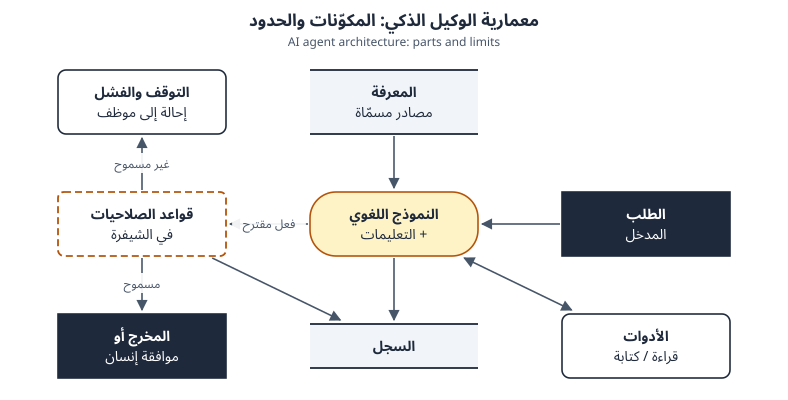

# معمارية الوكيل الذكي · AI Agent Architecture

**النوع:** نموذج · **المستوى:** أساسي · **المجال:** هندسة الأنظمة القائمة على الوكلاء · **المنشأ:** معروف عالمياً · **المرحلة:** بناء الوكيل

## الغرض

أن تقرّر على الورق ما الذي سيفعله الوكيل وبماذا، قبل أن تكتب تعليماته. تفرّق Anthropic بين سير عمل تُرسم خطواته في الشيفرة مسبقاً، ووكيل يقرّر النموذج فيه خطواته وأدواته بنفسه، وتوصي بأبسط حل يؤدي الغرض، وقد يكون ألا تبني نظاماً من هذا النوع أصلاً ([A81](../../SOURCES.md)). ورقة المعمارية هي ما يجعل هذا الاختيار صريحاً.

## متى يُستخدم

- قبل بناء أي وكيل، ولو كان بسيطاً.
- عند مراجعة وكيل قائم يتصرف بما لا تتوقعه.
- قبل منح الوكيل أداة جديدة أو صلاحية جديدة.

## متى لا يُستخدم

- حين تكفي قاعدة ثابتة أو أتمتة عادية؛ اسأل أولاً: هل نحتاج وكيلاً؟
- وثيقةً تُكتب بعد البناء لتبريره.
- مخططاً عاماً بلا أسماء أدوات ولا حدود؛ قيمة الورقة في تحديدها.

## المدخلات

- خريطة سير العمل من المقرر الأول، وفيها تصنيف الخطوات.
- قائمة الأنظمة التي سيقرأ منها الوكيل أو يكتب فيها.
- ما لا يجوز أن يفعله الوكيل دون موافقة.

## الخطوات

1. اكتب الهدف في جملة: ما المهمة، ولمن، وما علامة إنجازها.
2. اختر الشكل: سير عمل بخطوات ثابتة، أو وكيل يختار خطواته. ابدأ بالأبسط.
3. عدِّد الأدوات: لكل أداة ما تقرؤه وما تكتبه، وهل لفعلها رجعة.
4. حدّد المعرفة والسياق: من أين يأخذ الوكيل حقائقه، وما الذي لا يجوز أن يختلقه.
5. اكتب الصلاحيات: يتصرف وحده، ينتظر موافقة، يحيل إلى موظف.
6. حدّد ما يُسجَّل، ومتى يتوقف الوكيل، وماذا يحدث عند الفشل.

## القالب

| المكوّن | ما تكتبه |
|---|---|
| الهدف | المهمة وعلامة الإنجاز |
| الشكل | سير عمل ثابت أو وكيل، ولماذا |
| النموذج | أي نموذج، ولماذا هو |
| التعليمات | الدور، والحدود، ولغة الرد |
| الأدوات | الاسم، يقرأ أو يكتب، هل للفعل رجعة |
| المعرفة | المصادر التي يُسمح بالاعتماد عليها |
| الصلاحيات | وحده، بموافقة، إحالة |
| التوقف والفشل | متى يتوقف، وماذا يقول، ولمن يحيل |
| السجل | ما يُحفظ عن كل طلب |

## مثال توضيحي

**سيناريو توضيحي.** وكيل مطابقة فواتير الموردين. الشكل: سير عمل ثابت من أربع خطوات، لأن الخطوات معروفة ولا تتغير. الأدوات: قراءة الفاتورة (قراءة فقط)، قراءة أمر الشراء (قراءة فقط)، كتابة ملاحظة في النظام المحاسبي (كتابة، ولها رجعة). الصلاحيات: يطابق وحده، ويحيل كل فرق في السعر أو الكمية إلى المحاسب، ولا يعتمد دفعاً أبداً. اعتماد الدفع غير موجود ضمن أدواته أصلاً.

## كيف يعين الوكيل الذكي

- يراجع الورقة ويشير إلى أداة كتابة بلا شرط موافقة، أو مصدر معرفة غير مسمّى.
- يقترح حالات اختبار لكل حد في الورقة.
- يحوّل الورقة إلى مسودة تعليمات للوكيل.
- **حدّه:** لا يقرّر الصلاحيات؛ من يتحمل نتيجة الفعل هو من يقرّرها.

## المخرج

ورقة تصميم من صفحة أو صفحتين، تكفي لأن يبني الوكيلَ شخصٌ آخر ويختبر حدوده.

## معايير الجودة

- لكل أداة: قراءة أم كتابة، وهل لفعلها رجعة.
- الأفعال التي لا رجعة فيها خارج أدوات الوكيل أو بموافقة.
- سبب اختيار الشكل مكتوب، ومنه لماذا لم يكفِ الأبسط.
- حالة الفشل مكتوبة: ماذا يقول الوكيل ولمن يحيل.

## المصدر والترخيص

التفريق بين سير العمل والوكيل، وتوصية البدء بالأبسط، من مقالة Anthropic «Building effective agents» ([A81](../../SOURCES.md))، وهي إرشاد هندسي من مزوّد لا معيار. مكوّنات الورقة من صياغة الأكاديمية في المقرر الثاني.

## في الأكاديمية

- [الدرس 2.1: تشريح الوكيل](../../03-courses/02-build/lessons/2-1-agent-anatomy.md)، وفيه المكوّنات وسؤال «هل تحتاج وكيلاً؟».
- [مخطط المنتج الأولي](../../04-entrepreneur-toolkit/07-ai-mvp-blueprint.md).

[فهرس المكتبة](../README.md)

