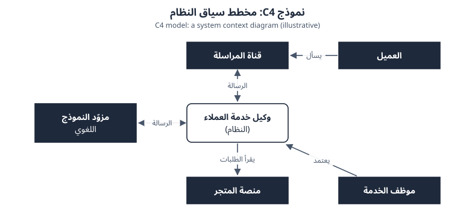

# نموذج C4 · C4 Model

**النوع:** نموذج · **المستوى:** تطبيقي · **المجال:** تحليل المتطلبات وتصميم الأنظمة · **المنشأ:** معروف عالمياً · **المرحلة:** بناء الوكيل، التوسع والحوكمة

## الغرض

أن ترسم البنية بقدر ما يحتاجه من ينظر. نموذج C4 من وضع Simon Brown: أربعة مخططات للبنية الثابتة، هي سياق النظام، والحاويات، والمكوّنات، والشيفرة، كل منها أقرب من سابقه، ليُروى لكل جمهور ما يناسبه. والنموذج لا يفرض رموزاً بعينها. والموقع ينص على أن مخططَي السياق والحاويات يكفيان أغلب فرق التطوير، وأن المستويات الأربعة ليست كلها لازمة ([A238](../../SOURCES.md)). ومخطط سياق النظام هو أول ما يُرسم: النظام في الوسط، وحوله من يستخدمه وما يتصل به.

## متى يُستخدم

- في أول التصميم: مخطط السياق في نصف ساعة.
- عند شرح النظام لمشترٍ أو مراجع أمني.
- عند انضمام مطوّر جديد.

## متى لا يُستخدم

- لرسم المستويات الأربعة لنموذج أولي؛ الأول يكفي.
- لوصف سير العمل أو البيانات.
- بمخطط شيفرة يُرسم باليد؛ يتقادم في أسبوع.

## المدخلات

- جملة واحدة: ماذا يفعل النظام ولمن.
- الأنظمة الخارجية التي يتصل بها.
- التطبيقات ومخازن البيانات التي يتكون منها.

## الخطوات

1. ارسم مخطط السياق: نظامك صندوقاً واحداً، وحوله الأشخاص والأنظمة الخارجية.
2. اكتب على كل سهم ما يمر فيه، لا «يتصل بـ».
3. ارسم مخطط الحاويات: التطبيقات ومخازن البيانات التي يتكون منها النظام، وما بينها.
4. انزل إلى المكوّنات في الحاوية التي يدور حولها النقاش فقط.
5. ضع على كل مخطط عنوانه ومفتاح رموزه وتاريخه.

## القالب

| المستوى | السؤال | الجمهور | هل أحتاجه الآن؟ |
|---|---|---|---|
| سياق النظام | من يستخدم النظام وبماذا يتصل؟ | الجميع | |
| الحاويات | ما التطبيقات ومخازن البيانات التي يتكون منها؟ | الفريق التقني والمراجع الأمني | |
| المكوّنات | ما أجزاء هذه الحاوية؟ | المطوّرون | |
| الشيفرة | كيف بُني هذا المكوّن؟ | المطوّرون، ويُولَّد آلياً | |

## مثال توضيحي

**سيناريو توضيحي.** مخطط سياق لوكيل خدمة عملاء في متجر إلكتروني.

في المخطط خمسة أطراف خارجية. السهم إلى مزوّد النموذج اللغوي مكتوب عليه ما يمر فيه: رسالة العميل بنصها. هذه الجملة هي ما سيسأل عنه المشتري أولاً.

## كيف يعين الوكيل الذكي

- يرسم مسودة السياق والحاويات من وصف المشروع وملفات الإعداد.
- يشير إلى سهم بلا وصف لما يمر فيه.
- يحدّث المخطط عند تغيّر البنية ويبيّن الفرق.
- **حدّه:** لا يثبت أن المخطط يطابق المنشور إلا بقراءة المنشور فعلاً.

## المخرج

مخطط سياق، ومخطط حاويات عند الحاجة، لكل منهما عنوان ومفتاح وتاريخ.

## معايير الجودة

- يفهم غير التقني مخطط السياق.
- على كل سهم ما يمر فيه.
- الأطراف الخارجية كلها ظاهرة، ومنها مزوّد النموذج.
- لا مستوى مرسوم بلا حاجة.

## المصدر والترخيص

النموذج وصاحبه ومستوياته ورخصته من موقع c4model.com ([A238](../../SOURCES.md)). الموقع يعرّف الحاوية بأنها تطبيق أو مخزن بيانات، ولا يفصّل في ما قُرئ منه ما يُظهره كل مخطط؛ فشرح المستويات في القالب من صياغة الأكاديمية على ما تدل عليه أسماؤها. «مخطط سياق النظام» كان اسماً مستقلاً في القائمة فدُمج هنا.

## في الأكاديمية

- [قالب البنية التشغيلية](../../03-courses/04-scale-and-govern/templates/operating-architecture.md) (operating-architecture.md).
- [قالب القرار المعماري](../../03-courses/02-build/templates/architecture-decision.md) (architecture-decision.md).

[فهرس المكتبة](../README.md)

