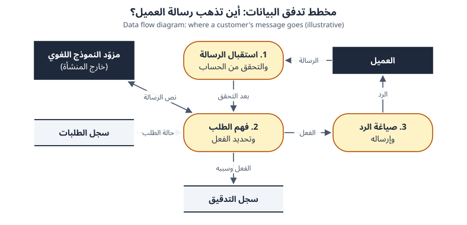

# مخطط تدفق البيانات · Data Flow Diagram (DFD)

**النوع:** نموذج · **المستوى:** تطبيقي · **المجال:** هندسة البيانات وتصميمها · **المنشأ:** معروف عالمياً · **المرحلة:** بناء الوكيل، الإطلاق والنموذج التجاري، التوسع والحوكمة

## الغرض

أن تجيب عن سؤال العميل والمراجع: أين تذهب بياناتي؟ يُرسم المخطط بأربعة رموز: طرف خارجي (مصدر البيانات أو وجهتها)، وعملية تحوّل البيانات، ومخزن بيانات، وتدفق بينها ([A199](../../SOURCES.md)). وفي المشاريع القائمة على الوكلاء طرف خارجي يُنسى كثيراً: مزوّد النموذج اللغوي، وإليه يذهب نص الرسالة.

## متى يُستخدم

- عند إعداد خريطة البيانات لجاهزية الامتثال.
- قبل اختيار مزوّد نموذج أو مكان استضافة.
- مدخلاً لنمذجة التهديدات: كل تدفق يعبر حدّ المنشأة موضع سؤال.

## متى لا يُستخدم

- لوصف ترتيب الخطوات والقرارات؛ المخطط لا يرسم تسلسلاً ولا شرطاً.
- بديلاً عن التقييم الذاتي لحماية البيانات.
- مخططاً واحداً بكل التفاصيل؛ ابدأ بمستوى عام ثم فصّل ما يلزم.

## المدخلات

- قائمة الأنظمة والمزوّدين.
- ما يُرسل إلى النموذج في كل استدعاء.
- أين تُحفظ السجلات والذاكرة.

## الخطوات

1. ارسم الأطراف الخارجية: العميل، ونظام العميل، ومزوّد النموذج، وأي مزوّد آخر.
2. ارسم العمليات الرئيسية، ثلاثاً إلى خمس، ورقّمها.
3. ارسم المخازن: قاعدة البيانات، والسجل، والذاكرة.
4. صِل التدفقات واكتب على كل سهم ما يحمله.
5. علِّم كل سهم يحمل بيانات شخصية، وكل سهم يعبر إلى خارج المنشأة أو خارج المملكة.

## القالب

| التدفق | من | إلى | ما يحمله | بيانات شخصية؟ | يعبر إلى خارج المنشأة؟ |
|---|---|---|---|---|---|
| | | | | | |

## مثال توضيحي

**سيناريو توضيحي.** رسالة عميل إلى وكيل متجر. السهم الذي يستوقف المراجع هو الذاهب إلى مزوّد النموذج: يحمل نص الرسالة، وقد يكون فيه اسم ورقم جوال.

المخطط مرسوم بأداة الأكاديمية `tools/build_diagrams.py` من ملف مواصفات نصي، فيُعدَّل بتعديل النص.

## كيف يعين الوكيل الذكي

- يستخرج مسودة التدفقات من ورقة المعمارية وعقود الأدوات.
- يعدّ الأسهم التي تحمل بيانات شخصية إلى طرف خارجي.
- ينبّه إلى مخزن بلا مدة حفظ.
- **حدّه:** لا يحكم بجواز نقل البيانات؛ يُحال ذلك إلى التقييم الذاتي ومستشار نظامي.

## المخرج

مخطط من صفحة واحدة، وجدول بالتدفقات التي تحمل بيانات شخصية ووجهة كل منها.

## معايير الجودة

- مزوّد النموذج مرسوم طرفاً خارجياً.
- على كل سهم ما يحمله.
- التدفقات الشخصية والعابرة معلَّمة.
- السجل والذاكرة مرسومان مخزنين.

## المصدر والترخيص

الرموز الأربعة كما تعرضها مادة تعليمية لجامعة كولورادو عن تقنية رسم مخططات تدفق البيانات ([A199](../../SOURCES.md)). المثال والقالب من صياغة الأكاديمية ورسمها.

## في الأكاديمية

- [الدرس 3.4: جاهزية الامتثال](../../03-courses/03-launch/lessons/3-4-compliance-readiness.md) (3-4-compliance-readiness.md)، وفيه خريطة البيانات.
- [التقييم الذاتي لحماية البيانات](../../02-saudi-market-knowledge-framework/compliance-toolkit/pdpl-self-assessment.md) (pdpl-self-assessment.md).

[فهرس المكتبة](../README.md)

