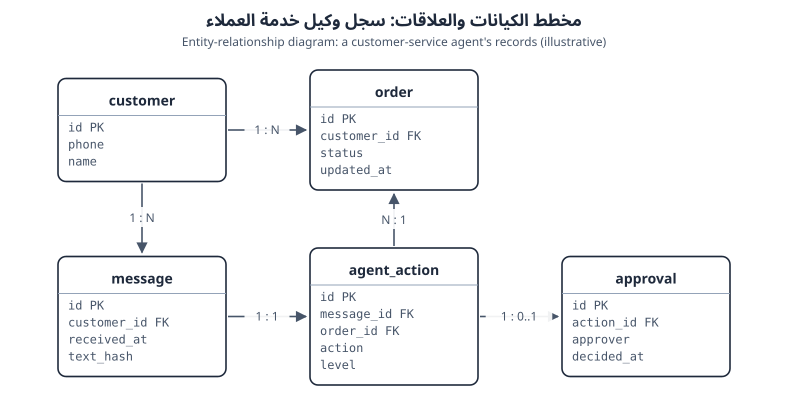

# مخطط الكيانات والعلاقات · Entity Relationship Diagram (ERD)

**النوع:** نموذج · **المستوى:** تطبيقي · **المجال:** هندسة البيانات وتصميمها · **المنشأ:** معروف عالمياً · **المرحلة:** بناء الوكيل

## الغرض

أن تصمّم البيانات قبل أن تمتلئ. اقترح Peter Chen نموذج الكيانات والعلاقات عام 1976 على أن العالم الحقيقي كيانات وعلاقات بينها، وقدّم معه تقنية رسم تُستخدم أداةً لتصميم قواعد البيانات ([A198](../../SOURCES.md)). في مشروع قائم على الوكلاء يضاف جدولان لا يحتاج إليهما تطبيق عادي: ما فعله الوكيل، ومن وافق عليه.

## متى يُستخدم

- قبل إنشاء أي جدول، ولو كان في جدول بيانات.
- عند تصميم سجل أفعال الوكيل والموافقات.
- قبل الربط بنظام العميل، لمعرفة أي حقل يقابل أي حقل.

## متى لا يُستخدم

- لمنتج يقرأ من نظام العميل ولا يخزّن شيئاً؛ يكفيه سرد الحقول التي يقرؤها.
- لوصف حركة البيانات؛ ذاك مخطط تدفق البيانات.
- تصميماً نهائياً من أول يوم؛ يتغير مع أول عميل.

## المدخلات

- مخطط الفئات أو قائمة الأشياء.
- ما يجب أن يُسجَّل عن كل طلب للتقييم وحساب التكلفة.
- ما يُعدّ بيانات شخصية.

## الخطوات

1. حوّل كل شيء يُخزَّن إلى كيان، واكتب مفتاحه.
2. اكتب الحقول، وعلِّم الشخصي منها.
3. ارسم العلاقات بأعدادها، والمفاتيح الأجنبية.
4. أضف كيان «فعل الوكيل» وكيان «الموافقة»، واربطهما بالطلب.
5. اسأل: هل يكفي هذا لحساب نسبة النجاح وتكلفة المهمة المنجزة؟ إن لم يكفِ فأضف الحقل الناقص.

## القالب

| الكيان | المفتاح | الحقول | بيانات شخصية؟ | يرتبط بـ (مع العدد) |
|---|---|---|---|---|
| | | | | |

## مثال توضيحي

**سيناريو توضيحي.** سجل وكيل خدمة عملاء. الرسالة تُحفظ ببصمة نصها لا بنصها، ولكل رسالة فعل واحد مسجَّل بمستواه، وبعض الأفعال لها موافقة باسم من وافق ووقت قراره.

المخطط مرسوم بأداة الأكاديمية `tools/build_diagrams.py` من ملف مواصفات نصي، فيُعدَّل بتعديل النص.

## كيف يعين الوكيل الذكي

- يقترح مسودة الكيانات من مخطط الفئات.
- يكتب من المخطط تعليمات إنشاء الجداول لتراجعها.
- يشير إلى حقل شخصي يُخزَّن بلا حاجة.
- **حدّه:** ما يُحفظ من بيانات العملاء وكم يُحفظ قرار امتثال، لا قرار تصميم.

## المخرج

مخطط كيانات وعلاقات، ومعه قائمة الحقول الشخصية ومدة حفظ كل منها.

## معايير الجودة

- لكل كيان مفتاح.
- أفعال الوكيل والموافقات كيانان مستقلان.
- الحقول الشخصية معلَّمة.
- السجل يكفي لحساب نسبة النجاح والتكلفة.

## المصدر والترخيص

النموذج من ورقة Peter Pin-Shan Chen، «The Entity-Relationship Model: Toward a Unified View of Data»، ACM Transactions on Database Systems، المجلد 1، العدد 1، 1976 ([A198](../../SOURCES.md)). الرسم هنا بصيغة الجداول والمفاتيح الشائعة اليوم، لا بترميز الورقة الأصلي.

## في الأكاديمية

- [بيانات المتجر المختلَق](../../05-agentic-ai-lab/datasets/ecommerce-store/README.md) (ecommerce-store/README.md).
- [الدرس 2.3](../../03-courses/02-build/lessons/2-3-tools-and-integrations.md) (2-3-tools-and-integrations.md)، وفيه البيانات التي تُسند إلى الأدوات.

[فهرس المكتبة](../README.md)

