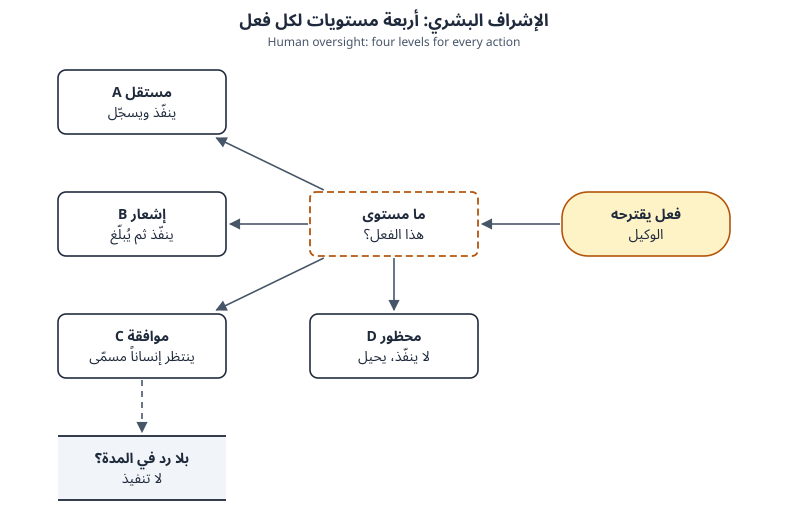

# الإشراف البشري على الوكيل · Human-in-the-Loop (HITL)

**النوع:** نموذج · **المستوى:** أساسي · **المجال:** هندسة الأنظمة القائمة على الوكلاء · **المنشأ:** معروف عالمياً · **المرحلة:** اكتشاف الفرصة، بناء الوكيل، التوسع والحوكمة

## الغرض

أن يكون لكل فعل صاحب بشري معروف. إرشادات فريق الخبراء الأوروبي للذكاء الاصطناعي الجدير بالثقة تسمّي ثلاث مقاربات: إنسان يراجع الفعل قبل تنفيذه (Human-in-the-loop)، وإنسان يراقب التنفيذ ويتدخل عند الحاجة (Human-on-the-loop)، وإنسان يملك قرار استخدام النظام وحدوده وإيقافه (Human-in-command) ([A40](../../SOURCES.md)). وهي إرشادات غير ملزمة من خارج المملكة، تُستخدم هنا مفرداتٍ لا مرجعاً نظامياً.

## متى يُستخدم

- عند تصميم الوكيل، لكل أداة كتابة.
- قبل توسيع صلاحيات وكيل قائم.
- عند كتابة شروط التجربة مع العميل: من يوافق، وخلال كم.

## متى لا يُستخدم

- ختماً شكلياً: موافقة يضغطها الموظف دون قراءة ليست إشرافاً.
- بديلاً عن التقييم؛ المراجع البشري لا يلتقط ما لم يُختبر.
- مراجعة لكل شيء؛ إن احتاج كل فعل موافقة فالمهمة لا تصلح لوكيل بعد.

## المدخلات

- قائمة أفعال الوكيل، وما له رجعة منها وما لا رجعة له.
- أثر الخطأ في كل فعل: مال، بيانات شخصية، سمعة.
- من يملك الوقت والمعرفة للمراجعة فعلاً.

## الخطوات

1. عدِّد الأفعال واحداً واحداً، لا «الوكيل» جملةً.
2. قدّر لكل فعل أثر الخطأ وهل له رجعة.
3. اختر مستوى الإشراف بحروف مصفوفة الإشراف البشري في عدّة الامتثال: A مستقل، B إشعار، C موافقة، D محظور.
4. سمِّ المسؤول ومدة الرد، وما يحدث إن لم يرد.
5. اكتب شرط الانتقال إلى مستوى أقل إشرافاً: كم حالة، وبأي نسبة نجاح، ومن يقرّر.

## القالب

| الفعل | له رجعة؟ | أثر الخطأ | مستوى الإشراف | المسؤول | مدة الرد وما بعدها | شرط التخفيف |
|---|---|---|---|---|---|---|
| | | | | | | |

## مثال توضيحي

**سيناريو توضيحي.** وكيل متابعة تحصيل. إرسال تذكير أول بصيغة معتمدة: ينفّذ وحده، ويراقب المحاسب عينة أسبوعية. اقتراح خطة تقسيط: يكتب المسودة والمحاسب يوافق قبل الإرسال؛ وإن لم يرد خلال يوم عمل تبقى المسودة ولا تُرسل. إيقاف الخدمة عن عميل: خارج أدوات الوكيل. شرط التخفيف لخطط التقسيط: خمسون مسودة متتالية قُبلت دون تعديل، ويقرّره المدير المالي.

## كيف يعين الوكيل الذكي

- يستخرج قائمة الأفعال من ورقة المعمارية ويشير إلى ما ليس له مستوى إشراف.
- يجهّز للمراجع ملخصاً يعينه على القرار: ما الفعل، ولماذا، وما البديل.
- يعدّ من السجل نسبة ما قُبل دون تعديل.
- **حدّه:** لا يخفّف مستوى الإشراف عن نفسه، ولا يُعدّ سكوت المراجع موافقة.

## المخرج

مصفوفة إشراف: لكل فعل مستواه ومسؤوله ومدة الرد وشرط التخفيف.

## معايير الجودة

- الأفعال التي لا رجعة فيها بموافقة مسبقة أو خارج الأدوات.
- لكل موافقة اسم شخص ومدة رد.
- عدم الرد لا يعني التنفيذ.
- شرط التخفيف رقمي ومكتوب قبل التشغيل.

## المصدر والترخيص

المصطلحات الثلاثة من «Ethics Guidelines for Trustworthy AI» لفريق الخبراء الرفيع المستوى في المفوضية الأوروبية، 2019 ([A40](../../SOURCES.md)). المصفوفة وشرط التخفيف من صياغة الأكاديمية.

## في الأكاديمية

- [الدرس 1.4](../../03-courses/01-opportunity/lessons/1-4-workflow-shadowing.md)، وفيه المستويات الثلاثة عند تصنيف الخطوات.
- [الدرس 2.6: ضوابط الحماية والموافقة البشرية](../../03-courses/02-build/lessons/2-6-guardrails-and-human-approval.md).
- [تمرين R3](../../05-agentic-ai-lab/exercises/r3-role-card-and-approval-matrix.md): بطاقة دور الوكيل ومصفوفة الاعتماد.
- [مصفوفة الإشراف البشري](../../02-saudi-market-knowledge-framework/compliance-toolkit/human-oversight-matrix.md) (human-oversight-matrix.md) في عدّة الامتثال، وهي القالب الذي تُملأ به هذه المصفوفة.
- [سلّم الاستقلالية](../../03-courses/01-opportunity/lessons/1-1-from-chatbots-to-agents.md) في الدرس 1.1 (1-1-from-chatbots-to-agents.md)، وهو ما يحدد أين يقف الوكيل كله.

[فهرس المكتبة](../README.md)

