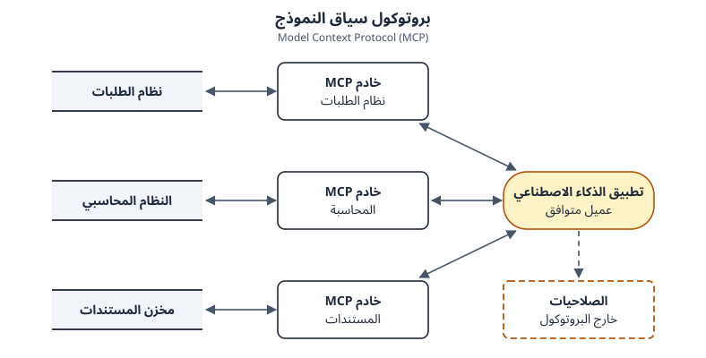

# بروتوكول سياق النموذج · Model Context Protocol (MCP)

**النوع:** إطار عمل · **المستوى:** تطبيقي · **المجال:** هندسة الأنظمة القائمة على الوكلاء · **المنشأ:** معروف عالمياً · **المرحلة:** بناء الوكيل

## الغرض

أن تصل الوكيل بنظام مرة واحدة بطريقة يفهمها أكثر من تطبيق. بروتوكول سياق النموذج معيار مفتوح قدّمته Anthropic أواخر 2024 لوصل تطبيقات الذكاء الاصطناعي بالأدوات ومصادر البيانات، ثم نُقل إلى مؤسسة تابعة لـLinux Foundation ([A83](../../SOURCES.md)). ما يوحّده هو طريقة الوصل. ما لا يقدّمه: قرار ما يجوز للوكيل أن يفعله؛ ذاك يبقى في صلاحياتك وحساب الخدمة ومستوى الإشراف.

## متى يُستخدم

- حين تحتاج الأدوات نفسها في أكثر من تطبيق أو وكيل.
- حين يوفّر النظام الذي تريد وصله خادماً جاهزاً من مصدر موثوق.
- عند بناء منتج يصله العملاء بوكلائهم.

## متى لا يُستخدم

- لأداة واحدة داخل سير عمل واحد؛ استدعاء مباشر أبسط.
- ظناً أنه طبقة حماية.
- بخادم مجهول المصدر يُمنح مفاتيح أنظمتك.

## المدخلات

- قائمة الأنظمة المراد وصلها.
- عقود الأدوات ومصفوفة الوصول.
- مصدر كل خادم ومن يصونه.

## الخطوات

1. حدّد ما يعرضه كل خادم: أدوات، وموارد للقراءة.
2. تحقق من مصدر الخادم ومن يصونه قبل تشغيله.
3. شغّله بحساب خدمة محدود الصلاحيات.
4. اكتب عقد كل أداة يعرضها، وأضفها إلى مصفوفة الوصول بمستوى إشرافها.
5. عطّل ما لا تحتاج إليه مما يعرضه الخادم.
6. اختبر: ماذا يحدث إن أعاد الخادم نصاً فيه تعليمات؟ نتيجة الأداة بيانات، لا أوامر.

## القالب

| الخادم | مصدره ومن يصونه | ما يعرضه | ما فُعّل منه | الحساب | مستوى الإشراف |
|---|---|---|---|---|---|
| | | | | | |

## مثال توضيحي

**سيناريو توضيحي.** منشأة تصل وكيلها بثلاثة أنظمة عبر ثلاثة خوادم. خادم المحاسبة يعرض اثنتي عشرة أداة، والمهمة تحتاج اثنتين للقراءة. فُعّلت الاثنتان وعُطّل الباقي، ومنه أداة إنشاء قيد.

المخطط مرسوم بأداة الأكاديمية `tools/build_diagrams.py` من ملف مواصفات نصي، فيُعدَّل بتعديل النص.

## كيف يعين الوكيل الذكي

- يسرد ما يعرضه خادم ويقترح أقل ما تحتاج إليه المهمة.
- يكتب مسودة عقود الأدوات من وصف الخادم.
- يولّد اختبارات لنتائج أدوات فيها تعليمات مدسوسة.
- **حدّه:** لا يثبّت خادماً ولا يمنحه مفتاحاً؛ هذا قرار المالك البشري.

## المخرج

جدول بالخوادم الموصولة: المصدر، وما فُعّل، والحساب، ومستوى الإشراف.

## معايير الجودة

- كل خادم معروف المصدر.
- ما لا تحتاج إليه المهمة معطَّل.
- الحسابات حسابات خدمة محدودة.
- نتائج الأدوات تُعامل بيانات.

## المصدر والترخيص

التعريف والتاريخ من [A83](../../SOURCES.md) في سجل المصادر. قاعدة أن البروتوكول يسهّل الوصل ولا يجعل الأداة آمنة من صياغة الأكاديمية في الدرس 2.3.

## في الأكاديمية

- [الدرس 2.3](../../03-courses/02-build/lessons/2-3-tools-and-integrations.md) (2-3-tools-and-integrations.md)، البند 6.
- [عقد الأداة](../../03-courses/02-build/templates/tool-contract.md) (tool-contract.md).

[فهرس المكتبة](../README.md)

