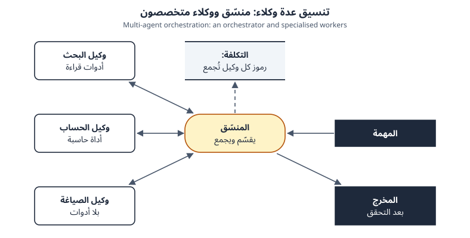

# تنسيق عدة وكلاء · Multi-Agent Orchestration

**النوع:** نموذج · **المستوى:** تطبيقي · **المجال:** هندسة الأنظمة القائمة على الوكلاء · **المنشأ:** معروف عالمياً · **المرحلة:** بناء الوكيل، التوسع والحوكمة

## الغرض

أن تعرف متى تقسّم، لا كيف فقط. توصية Anthropic أن يُبدأ بأبسط حل وألا يُزاد التعقيد إلا عند الحاجة ([A81](../../SOURCES.md)). وفي وصفها لنظام بحث متعدد الوكلاء بنته، تذكر أن الأنظمة المتعددة الوكلاء استهلكت في بياناتها نحو خمسة عشر ضعف رموز المحادثة العادية، فلا تصلح إلا لمهام قيمتها تحتمل ذلك ([A87](../../SOURCES.md)). القسمة قرار تكلفة قبل أن تكون قرار تصميم.

## متى يُستخدم

- حين يتراجع اختيار الوكيل للأداة الصحيحة كلما زادت أدواته، بقياس على مجموعة التقييم.
- حين تتمايز أجزاء المهمة في سياقها وصلاحياتها.
- حين يمكن تنفيذ أجزاء بالتوازي وقيمة المهمة تحتمل التكلفة.

## متى لا يُستخدم

- لأن الرسم بعدة وكلاء يبدو أجمل.
- قبل أن يعمل وكيل واحد ويُقيَّم.
- حين تكون التسليمات بين الوكلاء أكثر من العمل نفسه.

## المدخلات

- نتائج تقييم الوكيل الواحد وموضع إخفاقه.
- تكلفة المهمة المنجزة اليوم.
- حدود كل جزء: أدواته وصلاحياته.

## الخطوات

1. أثبت بالقياس أن وكيلاً واحداً لا يكفي، واكتب أين يخفق.
2. قسّم على حدود الصلاحيات والسياق، لا على أسماء الأقسام.
3. اختر المنسّق: شيفرة ثابتة حيث يمكن، ووكيل منسّق حيث لا يمكن.
4. اكتب عقد التسليم بين كل وكيلين: ما يُسلَّم، وبأي صيغة، وما يحدث عند النقص.
5. قيّم كل وكيل وحده، ثم النظام كله.
6. احسب تكلفة المهمة المنجزة من جديد وقارنها بالوكيل الواحد.

## القالب

| الوكيل | مهمته | أدواته وصلاحياته | ما يستلمه | ما يسلّمه | من يتحقق من مخرجه |
|---|---|---|---|---|---|
| | | | | | |

## مثال توضيحي

**سيناريو توضيحي.** وكيل واحد لتلخيص المنافسات الحكومية كان يخطئ في الحساب حين يجمع البحث والحساب والصياغة. قُسّم ثلاثة: بحث بأدوات قراءة، وحساب بأداة حاسبة، وصياغة بلا أدوات، ومنسّق يتحقق قبل التسليم. ارتفعت الدقة وتضاعفت الرموز، فأُعيد حساب السعر.

المخطط مرسوم بأداة الأكاديمية `tools/build_diagrams.py` من ملف مواصفات نصي، فيُعدَّل بتعديل النص.

## كيف يعين الوكيل الذكي

- يحلّل سجل الإخفاقات ويقترح حدود القسمة.
- يكتب مسودة عقود التسليم.
- يقارن تكلفة النظامين من السجل.
- **حدّه:** القسمة تُعتمد بقياس، لا باقتراح وكيل.

## المخرج

جدول الوكلاء وعقود التسليم، وتقييم لكل وكيل وللنظام، ومقارنة تكلفة بالوكيل الواحد.

## معايير الجودة

- للقسمة سبب مقيس ومكتوب.
- لكل تسليم عقد.
- قُيّم كل وكيل وحده.
- حُسبت التكلفة قبل القسمة وبعدها.

## المصدر والترخيص

توصية البدء بالأبسط من مقالة Anthropic «Building effective agents» ([A81](../../SOURCES.md))، ورقم الاستهلاك من مقالتها «How we built our multi-agent research system» ([A87](../../SOURCES.md))، وهو من بيانات المزوّد نفسه لا قياس عام. الخطوات والقالب من صياغة الأكاديمية.

## في الأكاديمية

- [الدرس 2.7: من وكيل واحد إلى عدة وكلاء](../../03-courses/02-build/lessons/2-7-from-one-agent-to-several.md) (2-7-from-one-agent-to-several.md).
- [الدرس 4.1: المنشأة التي يشغّلها الوكلاء](../../03-courses/04-scale-and-govern/lessons/4-1-the-agent-operated-company.md) (4-1-the-agent-operated-company.md).

[فهرس المكتبة](../README.md)

