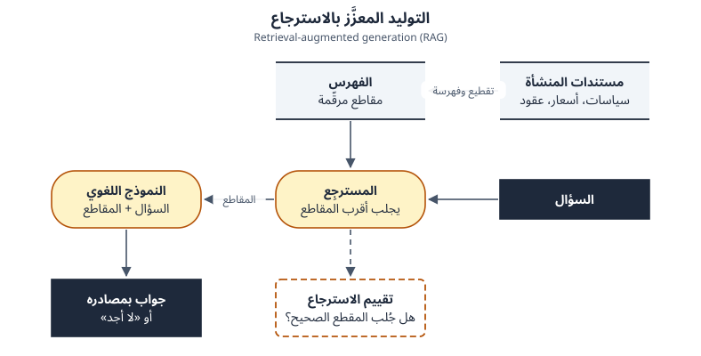

# التوليد المعزَّز بالاسترجاع · Retrieval-Augmented Generation (RAG)

**النوع:** نموذج · **المستوى:** تطبيقي · **المجال:** هندسة الأنظمة القائمة على الوكلاء · **المنشأ:** معروف عالمياً · **المرحلة:** بناء الوكيل

## الغرض

أن تكون إجابات الوكيل من مستندات المنشأة لا من ذاكرة النموذج. الورقة التي سمّت الطريقة، لـLewis وزملائه عام 2020، تجمع ذاكرتين: ما في أوزان النموذج، وفهرساً خارجياً يُجلب منه بمسترجِع؛ وتذكر من مزاياها أن المعرفة الخارجية تُحدَّث وتُفحص ([A201](../../SOURCES.md)). وحسن الاسترجاع يخدم قاعدة أعم: السياق مورد محدود، والمطلوب أقل قدر من النص يؤدي الغرض ([A82](../../SOURCES.md)).

## متى يُستخدم

- حين تعتمد الإجابة على مستندات تتغير: سياسات، أسعار، عقود.
- حين تكبر المستندات عن أن تُحمَّل كلها في السياق.
- حين يجب أن يذكر الوكيل مصدر جوابه.

## متى لا يُستخدم

- لمعلومة في نظام يُسأل بأداة: حالة طلب، رصيد. تلك أداة، لا استرجاع.
- لمستندات قليلة قصيرة تتسع لها التعليمات.
- علاجاً لضعف التعليمات أو غياب التقييم.

## المدخلات

- المستندات المعتمدة، بنسخها الحالية.
- أسئلة حقيقية مع المقطع الذي يجيب عن كل منها.
- مالك لكل مستند يحدّثه.

## الخطوات

1. اختر المستندات المعتمدة فقط، واكتب مالك كل منها وتاريخه.
2. قطّعها مقاطع لكل منها معنى تام ومرجع.
3. ابنِ الفهرس وجرّب الاسترجاع وحده: هل يُجلب المقطع الصحيح لكل سؤال؟
4. اطلب من النموذج أن يجيب من المقاطع فقط، وأن يذكر مرجعه، وأن يقول «لا أجد» إن لم يجد.
5. قيّم على مرحلتين: الاسترجاع، ثم الجواب.
6. حدّث الفهرس عند كل تغيير في مستند، وأعد التقييم.

## القالب

| السؤال | المقطع الذي يجب أن يُجلب | جُلب؟ | الجواب صحيح ومن المقطع؟ | ذُكر المصدر؟ |
|---|---|---|---|---|
| | | | | |

## مثال توضيحي

**سيناريو توضيحي.** وكيل متجر يُسأل عن سياسة الإرجاع بالعربية الدارجة. في التقييم ظهر أن الجواب الخاطئ سببه الاسترجاع لا النموذج: سياسة قديمة ما زالت في الفهرس. الحل كان حذف النسخة القديمة وتعيين مالك للمستند، لا تغيير النموذج.

المخطط مرسوم بأداة الأكاديمية `tools/build_diagrams.py` من ملف مواصفات نصي، فيُعدَّل بتعديل النص.

## كيف يعين الوكيل الذكي

- يقترح أسئلة اختبار من المستندات نفسها، ومنها أسئلة لا جواب لها فيها.
- يفصل في تقرير التقييم بين خطأ الاسترجاع وخطأ الجواب.
- ينبّه إلى مستندين متعارضين في الفهرس.
- **حدّه:** لا يقرّر أي مستند هو المعتمد؛ مالك المستند يقرّر.

## المخرج

فهرس من مستندات معتمدة لها مالك وتاريخ، ومجموعة تقييم تقيس الاسترجاع والجواب كلاً على حدة.

## معايير الجودة

- الاسترجاع قُيّم وحده قبل الجواب.
- الوكيل يقول «لا أجد» حين لا يجد.
- لكل جواب مرجع.
- لكل مستند مالك وتاريخ، ولا نسخ قديمة في الفهرس.

## المصدر والترخيص

Lewis وآخرون، «Retrieval-Augmented Generation for Knowledge-Intensive NLP Tasks»، NeurIPS 2020 ([A201](../../SOURCES.md)). وقاعدة السياق المحدود من مقالة Anthropic عن هندسة السياق ([A82](../../SOURCES.md)). الخطوات والقالب من صياغة الأكاديمية.

## في الأكاديمية

- [الدرس 2.2: هندسة السياق بالعربية](../../03-courses/02-build/lessons/2-2-context-engineering-in-arabic.md) (2-2-context-engineering-in-arabic.md).
- [قالب التقييم](../../05-agentic-ai-lab/evaluation/eval-template.md) (eval-template.md).

[فهرس المكتبة](../README.md)

