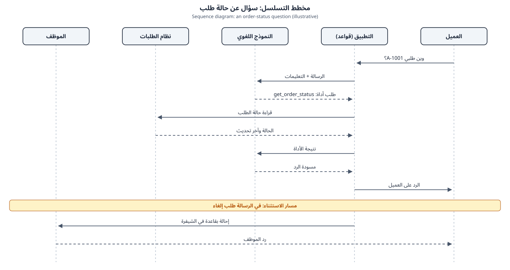

# مخطط التسلسل · Sequence Diagram

**النوع:** نموذج · **المستوى:** تطبيقي · **المجال:** تحليل المتطلبات وتصميم الأنظمة · **المنشأ:** معروف عالمياً · **المرحلة:** بناء الوكيل

## الغرض

أن ترى التفاعل خطوة خطوة، فيظهر أين يُتحقق من الصلاحية ومن ينفّذ الأداة فعلاً. مخطط التسلسل أحد مخططات UML ([A197](../../SOURCES.md)). وهو أوضح طريقة لشرح حقيقة يغفل عنها كثيرون: النموذج اللغوي لا ينفّذ شيئاً؛ يطلب أداة، والتطبيق هو من يتحقق وينفّذ.

## متى يُستخدم

- عند تصميم استدعاء الأدوات ومسار الموافقة.
- عند تتبّع خطأ: أي رسالة لم تصل، أو وصلت قبل أوانها.
- لشرح مسار الاستثناء والإحالة للعميل.

## متى لا يُستخدم

- لوصف بنية البيانات؛ ذاك مخطط الفئات أو الكيانات.
- لسير عمل بشري طويل بين أقسام؛ ذاك مخطط المسارات.
- بكل الحالات في مخطط واحد؛ لكل سيناريو مخططه.

## المدخلات

- سيناريو واحد محدد.
- قائمة الأطراف: بشر وأنظمة.
- عقود الأدوات.

## الخطوات

1. اكتب الأطراف في رأس المخطط بترتيب أول ظهور.
2. ارسم الرسائل بالترتيب: طلب بخط متصل، ورد بخط متقطع.
3. ضع التحقق من الصلاحية عند الطرف الذي يفرضه: التطبيق، لا النموذج.
4. ارسم مسار الاستثناء في المخطط نفسه أو في مخطط ثانٍ.
5. تتبّع المخطط مع السجل الفعلي لرسالة واحدة؛ إن اختلفا فأحدهما خطأ.

## القالب

| # | من | إلى | الرسالة | نوعها: طلب، رد، إحالة |
|---|---|---|---|---|
| | | | | |

## مثال توضيحي

**سيناريو توضيحي.** عميل يسأل عن طلبه. النموذج يطلب الأداة، والتطبيق ينفّذها ويعيد النتيجة، ثم يُرسل الرد. وفي مسار الاستثناء، رسالة فيها طلب إلغاء تُحال إلى الموظف بقاعدة في الشيفرة، دون أن يمر القرار بالنموذج.

المخطط مرسوم بأداة الأكاديمية `tools/build_diagrams.py` من ملف مواصفات نصي، فيُعدَّل بتعديل النص.

## كيف يعين الوكيل الذكي

- يرسم مسودة التسلسل من وصف السيناريو.
- يقارن المخطط بسجل تشغيل فعلي ويبيّن الخطوة المخالفة.
- يولّد حالات اختبار لكل رسالة قد تفشل.
- **حدّه:** لا يقرّر أين يُفرض التحقق؛ هذا قرار تصميم يملكه الفريق.

## المخرج

مخطط لكل سيناريو مهم: المسار المعتاد ومسار الاستثناء.

## معايير الجودة

- كل أداة ينفّذها التطبيق، لا النموذج.
- مسار الاستثناء مرسوم.
- المخطط يطابق سجل رسالة حقيقية.
- سيناريو واحد في المخطط.

## المصدر والترخيص

مخطط التسلسل من تقنيات UML، مواصفة Object Management Group ([A197](../../SOURCES.md)). المثال والقالب من صياغة الأكاديمية ورسمها.

## في الأكاديمية

- [الدرس 2.3: الأدوات والتكاملات](../../03-courses/02-build/lessons/2-3-tools-and-integrations.md) (2-3-tools-and-integrations.md)، وفيه كيف يعمل استدعاء الأدوات.
- [قوالب الوكلاء القابلة للتشغيل](../../05-agentic-ai-lab/agent-templates/workflows/README.md) (workflows/README.md)، وعقدها تُقرأ بالترتيب نفسه.

[فهرس المكتبة](../README.md)

