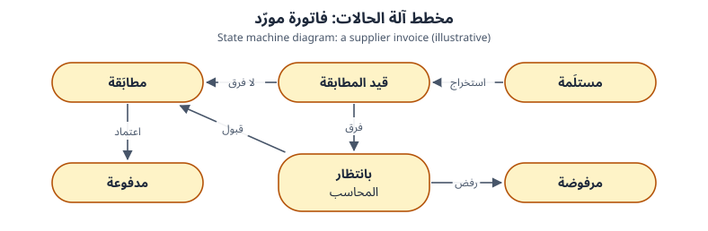

# مخطط آلة الحالات · State Machine Diagram

**النوع:** أداة أو قالب · **المستوى:** تطبيقي · **المجال:** تحليل المتطلبات وتصميم الأنظمة · **المنشأ:** معروف عالمياً · **المرحلة:** بناء الوكيل

## الغرض

أن تعرف في كل لحظة أين يقف الطلب وما المسموح بعده. آلة الحالات في UML تصف شيئاً يكون دائماً في حالة واحدة من حالات معدودة، وله انتقالات مشروطة بينها. الحالة تحدد كيف يستجيب للأحداث، والانتقال يطلقه حدث وقد يحمل شرطاً يُكتب بين قوسين مربعين وفعلاً يُنفَّذ معه، والمخطط يبدأ من دائرة مصمتة تدل على الحالة الأولى ([A236](../../SOURCES.md)). والوكيل الذي يعمل على طلبات تمتد أياماً لا يُضبط إلا بها: «بانتظار الموافقة» حالة لا يُنفَّذ فيها شيء.

## متى يُستخدم

- لكل كيان له دورة حياة: طلب، فاتورة، تذكرة، موافقة.
- عند تصميم الموافقة البشرية: ما الحالة أثناء الانتظار، وماذا بعد انقضاء المهلة؟
- حين تظهر في السجل حالات «عالقة» لا يعرف أحد كيف وصلت.

## متى لا يُستخدم

- لوصف خطوات إجراء؛ ذلك لمخطط النشاط.
- لكيان له حالتان فقط؛ يكفيه حقل.
- رسماً يُحفظ في ملف ولا يُفرض في الشيفرة.

## المدخلات

- الكيان المقصود وحقل حالته.
- الأحداث التي تغيّره، ومن يطلقها.
- قواعد الإشراف: أي انتقال يحتاج إنساناً.

## الخطوات

1. عدّد الحالات بأسماء يفهمها صاحب العمل.
2. لكل حالة: ما الأحداث التي تُخرج منها، وإلى أين؟
3. اكتب على كل انتقال حدثه، وشرطه إن وُجد، ومن يملكه: الوكيل أو إنسان مسمّى.
4. ابحث عن حالة بلا مخرج، وعن انتقال لا يملكه أحد.
5. افرض الجدول في الشيفرة: انتقال غير مدرج يُرفض ويُسجَّل.

## القالب

| من حالة | الحدث | الشرط | إلى حالة | من يملك الانتقال | ما يُسجَّل |
|---|---|---|---|---|---|
| | | | | | |

## مثال توضيحي

**سيناريو توضيحي.** فاتورة مورّد عند وكيل المطابقة.

لا سهم من «قيد المطابقة» إلى «مدفوعة». الدفع لا يُبلغ إلا عبر «مطابَقة» ثم اعتماد، وما فيه فرق لا يخرج من «بانتظار المحاسب» إلا بقرار المحاسب. هذه القاعدة في الجدول، والشيفرة ترفض ما عداه.

## كيف يعين الوكيل الذكي

- يستخرج الحالات والانتقالات من وصف الإجراء ومن سجل التشغيل.
- يكشف الحالات العالقة والانتقالات الواقعة فعلاً وغير المرسومة.
- يكتب اختبارات ترفض الانتقالات غير المدرجة.
- **حدّه:** الوكيل لا يغيّر جدول الانتقالات الذي يحكمه.

## المخرج

مخطط حالات وجدول انتقالات مفروض في الشيفرة.

## معايير الجودة

- لا حالة بلا مخرج إلا النهائية.
- كل انتقال له مالك.
- حالة الانتظار لها مهلة ومآل.
- الشيفرة ترفض ما ليس في الجدول.

## المصدر والترخيص

التعريفات وأساس الرسم من مقالة Wikipedia عن آلة الحالات في UML ([A236](../../SOURCES.md))؛ قُرئت لأن الصفحة التعليمية المتخصصة لم تُفتح يوم الإعداد، والمواصفة UML 2.5.1 ([A197](../../SOURCES.md)) هي المرجع. الرسم والجدول والمثال من إعداد الأكاديمية.

## في الأكاديمية

- [الدرس 2.6: الضوابط والموافقة البشرية](../../03-courses/02-build/lessons/2-6-guardrails-and-human-approval.md) (2-6-guardrails-and-human-approval.md).
- [قالب وكيل مطابقة الفواتير](../../05-agentic-ai-lab/agent-templates/04-invoice-reconciliation.md) (04-invoice-reconciliation.md).

[فهرس المكتبة](../README.md)

