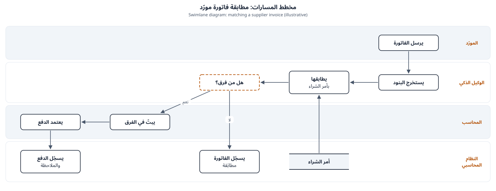

# مخطط المسارات · Swimlane Diagram

**النوع:** نموذج · **المستوى:** تطبيقي · **المجال:** إدارة المنتجات والمشاريع · **المنشأ:** معروف عالمياً · **المرحلة:** اكتشاف الفرصة

## الغرض

أن ترى التسليمات: أكثر التأخير والخطأ يقع حين ينتقل العمل من يد إلى يد. في معيار BPMN، المسار (Lane) قسم فرعي داخل العملية يمتد على طولها، ويُستخدم غالباً لتمثيل الجهات أو الأدوار ([A200](../../SOURCES.md)، [A44](../../SOURCES.md)). وحين تضيف مساراً للوكيل الذكي يظهر في الرسم ما سيتغير، وما يبقى عند البشر.

## متى يُستخدم

- بعد مراقبة سير العمل، لرسمه كما هو اليوم.
- عند تصميم الوضع الجديد: أي خطوات تنتقل إلى مسار الوكيل.
- لشرح التغيير للموظفين الذين يؤدون العمل.

## متى لا يُستخدم

- لعمل يؤديه شخص واحد من أوله إلى آخره.
- رسماً للإجراء المكتوب؛ المطلوب العمل كما يُؤدّى فعلاً.
- بكل الاستثناءات في رسم واحد؛ ارسم المسار المعتاد ثم أهم استثناءين.

## المدخلات

- ملاحظات المراقبة.
- قائمة من يشاركون في العمل، بشراً وأنظمة.
- الاستثناءات الأكثر تكراراً.

## الخطوات

1. اكتب مساراً لكل طرف: العميل أو المورّد، الموظفون بأدوارهم، الأنظمة.
2. ضع كل خطوة في مسار من يؤديها، بالترتيب.
3. ارسم الأسهم؛ كل سهم يعبر من مسار إلى مسار تسليم.
4. علِّم نقاط القرار، وعند كل تسليم: كم ينتظر العمل؟ وما الذي يضيع؟
5. ارسم الوضع الجديد بمسار للوكيل، وقارن عدد التسليمات.

## القالب

رسماً، أو جدولاً يقوم مقامه في [حزمة خريطة سير العمل](../../03-courses/01-opportunity/templates/workflow-map.md):

| # | الخطوة | المسار (من يؤديها) | تُسلَّم إلى | الانتظار عند التسليم | قرار؟ |
|---|---|---|---|---|---|
| | | | | | |

## مثال توضيحي

**سيناريو توضيحي.** مطابقة فاتورة مورّد بعد إدخال الوكيل. الوكيل يستخرج ويطابق، والقرار في الفرق واعتماد الدفع باقيان في مسار المحاسب. الفاتورة المطابِقة لا تمر بالمحاسب أصلاً، وهذا موضع التوفير.

المخطط مرسوم بأداة الأكاديمية `tools/build_diagrams.py` من ملف مواصفات نصي، فيُعدَّل بتعديل النص.

## كيف يعين الوكيل الذكي

- يحوّل ملاحظات المراقبة إلى مسودة خطوات موزعة على المسارات.
- يعدّ التسليمات ويقارن الوضعين.
- يشير إلى خطوة بلا صاحب.
- **حدّه:** لا يرسم ما لم يُراقَب؛ خريطة من وصف المدير ليست خريطة العمل.

## المخرج

مخططان: العمل اليوم، والعمل بعد الوكيل، مع عدد التسليمات في كل منهما.

## معايير الجودة

- كل خطوة في مسار واحد.
- القرارات واعتماد المال في مسار بشري.
- التسليمات معدودة وعندها زمن الانتظار.
- الرسم يطابق ما رُوقب.

## المصدر والترخيص

تعريف المسار من مواصفة BPMN 2.0.2 كما تنقله وثائق أدوات تطبّقها، وكونه يمثل الجهات غالباً من دليل ARIS ([A200](../../SOURCES.md)). ومواصفة BPMN في [A44](../../SOURCES.md). المثال من صياغة الأكاديمية ورسمها.

## في الأكاديمية

- [حزمة خريطة سير العمل](../../03-courses/01-opportunity/templates/workflow-map.md) (workflow-map.md).
- [الدرس 1.4: مراقبة سير العمل](../../03-courses/01-opportunity/lessons/1-4-workflow-shadowing.md) (1-4-workflow-shadowing.md).

[فهرس المكتبة](../README.md)

