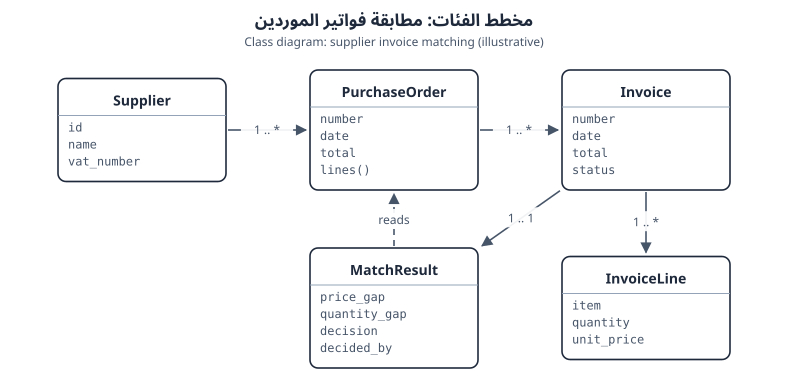

# مخطط الفئات · UML Class Diagram

**النوع:** نموذج · **المستوى:** تطبيقي · **المجال:** تحليل المتطلبات وتصميم الأنظمة · **المنشأ:** معروف عالمياً · **المرحلة:** بناء الوكيل

## الغرض

أن يتفق الفريق على مفردات النظام: ما «الفاتورة»؟ وما علاقتها بأمر الشراء؟ لغة النمذجة الموحّدة (UML) مواصفة من Object Management Group تعرّف لغة رسومية لتصوير أنظمة البرمجيات وتوثيقها، وإصدارها الحالي 2.5.1. ومخطط الفئات فيها يصف البنية الثابتة للنظام: فئات، ولكل فئة خصائص وعمليات، وعلاقات بينها ([A197](../../SOURCES.md)). للمؤسس قيمته أبسط من ذلك: قائمة متفق عليها بالأشياء التي سيقرأ عنها الوكيل ويكتب.

## متى يُستخدم

- قبل كتابة عقود الأدوات: الأداة تقرأ «شيئاً» وتكتب «شيئاً»، والمخطط يسمّيهما.
- حين يختلف الفريق والعميل على معنى كلمة: طلب، حجز، عميل.
- عند شرح النظام لمطوّر جديد أو لمن يفحصه تقنياً.

## متى لا يُستخدم

- لمنتج أولي من أداة واحدة وجدول واحد.
- بكل تفاصيل المواصفة؛ يكفي المؤسسَ الفئاتُ وأهم الخصائص والعلاقات.
- بديلاً عن مخطط الكيانات والعلاقات عند تصميم قاعدة البيانات نفسها.

## المدخلات

- خريطة سير العمل وما يرد فيها من مستندات وسجلات.
- أسماء الأشياء كما يسمّيها العميل.
- قائمة الأدوات التي سيستخدمها الوكيل.

## الخطوات

1. استخرج الأسماء من خريطة سير العمل: كل مستند أو سجل مرشح لأن يكون فئة.
2. اكتب لكل فئة ثلاث خصائص إلى ست، مما يحتاج إليه الوكيل فعلاً.
3. ارسم العلاقات واكتب العدد: واحد إلى كثير، واحد إلى واحد.
4. علِّم ما يقرؤه الوكيل وما يكتبه؛ ما يكتبه يحتاج مستوى إشراف.
5. اعرض المخطط على من يؤدي العمل اليوم وصحّح الأسماء بلسانه.

## القالب

| الفئة | أهم خصائصها | علاقتها بغيرها (مع العدد) | يقرؤها الوكيل أم يكتبها |
|---|---|---|---|
| | | | |

## مثال توضيحي

**سيناريو توضيحي.** مطابقة فواتير الموردين: خمس فئات تكفي لوصف المهمة. الوكيل يقرأ أمر الشراء والفاتورة وبنودها، ويكتب شيئاً واحداً: نتيجة المطابقة، وفيها من بتّ في الفرق.

المخطط مرسوم بأداة الأكاديمية `tools/build_diagrams.py` من ملف مواصفات نصي، فيُعدَّل بتعديل النص.

## كيف يعين الوكيل الذكي

- يستخرج مسودة الفئات والخصائص من وصف العمل أو من عيّنة مستندات.
- يشير إلى خاصية تستخدمها أداة وليست في المخطط.
- يحوّل المخطط المتفق عليه إلى مسودة عقود أدوات.
- **حدّه:** الأسماء والمعاني تُؤخذ من أصحاب العمل، لا من تخمين الوكيل.

## المخرج

مخطط من صفحة واحدة بفئات المهمة وعلاقاتها، وعلامة على ما يقرؤه الوكيل وما يكتبه.

## معايير الجودة

- الأسماء بلسان العميل.
- لكل علاقة عدد.
- ما يكتبه الوكيل معلَّم وله مستوى إشراف.
- لا فئة لا تستخدمها خطوة في سير العمل.

## المصدر والترخيص

لغة UML وإصدارها من صفحة المواصفة لدى Object Management Group، ووصف مخطط الفئات من ورقة تعريفية بتقنيات UML ([A197](../../SOURCES.md)). المخطط والقالب من صياغة الأكاديمية ورسمها.

## في الأكاديمية

- [بيانات المتجر المختلَق](../../05-agentic-ai-lab/datasets/ecommerce-store/README.md) في المختبر (ecommerce-store/README.md): حسابات وطلبات يصلح رسمها تمريناً.
- [ملف الفحص التقني](../../04-entrepreneur-toolkit/12-agentic-due-diligence-pack.md) (12-agentic-due-diligence-pack.md)، وفيه ما يطلبه من يفحص المنتج.

[فهرس المكتبة](../README.md)

