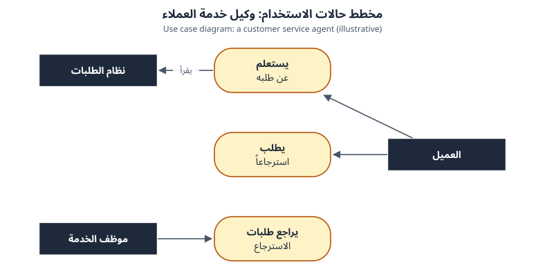

# مخطط حالات الاستخدام · Use Case Diagram

**النوع:** أداة أو قالب · **المستوى:** تطبيقي · **المجال:** تحليل المتطلبات وتصميم الأنظمة · **المنشأ:** معروف عالمياً · **المرحلة:** بناء الوكيل

## الغرض

أن ترى نطاق النظام في صفحة قبل أن تكتب متطلباً واحداً. مخطط حالات الاستخدام من مخططات UML السلوكية: يبيّن مجموعة الأفعال (حالات الاستخدام) التي يؤديها النظام بالتعاون مع مستخدمين من خارجه (الفاعلين)، وكل حالة استخدام تنتهي بنتيجة ظاهرة لها قيمة عند فاعل أو صاحب مصلحة، والنظام محل التصميم يسمّى «الموضوع» ([A234](../../SOURCES.md)). في مشروع قائم على الوكلاء يجيب المخطط عن سؤال يسبق كل بناء: ما الذي يفعله الوكيل، ولمن، وما الذي يبقى خارج حدّه؟

## متى يُستخدم

- في أول التصميم، لتثبيت نطاق النسخة الأولى.
- عند شرح النظام لعميل أو شريك غير تقني.
- حين يتسع النطاق في كل اجتماع ولا أحد يعرف أين يقف.

## متى لا يُستخدم

- لوصف ترتيب الخطوات؛ ذلك لمخطط النشاط أو التسلسل.
- بديلاً عن معايير القبول؛ الشكل البيضوي لا يقول متى تنجح الحالة.
- بعشرات الحالات في صفحة؛ قسّمه أو ارفع مستواه.

## المدخلات

- خريطة سير العمل الحالي.
- قائمة بمن يتعامل مع النظام: أشخاص وأنظمة.
- ما تقرر استبعاده من النسخة الأولى.

## الخطوات

1. ارسم حدّ النظام واكتب اسمه.
2. ضع الفاعلين خارجه: كل من يطلب من النظام شيئاً أو يعطيه شيئاً، إنساناً كان أو نظاماً.
3. اكتب داخل الحدّ حالات الاستخدام بصيغة فعل ونتيجة: «يستعلم عن طلبه».
4. صِل كل فاعل بما يخصه من الحالات.
5. اكتب تحت المخطط ما استُبعد، ثم حوّل كل حالة إلى قصة مستخدم بمعايير قبول.

## القالب

| الفاعل | حالة الاستخدام | النتيجة التي يراها | داخل النسخة الأولى؟ |
|---|---|---|---|
| | | | |

## مثال توضيحي

**سيناريو توضيحي.** وكيل خدمة عملاء لمتجر إلكتروني.

المخطط يُظهر ما غاب عن وصف المؤسس: موظف الخدمة فاعل له حالة استخدام خاصة به، وهي مراجعة طلبات الاسترجاع. من دونها كان الوكيل سيُبنى بلا واجهة للإنسان الذي يعتمد.

## كيف يعين الوكيل الذكي

- يستخرج الفاعلين وحالات الاستخدام من وصف المشروع أو من محاضر المقابلات.
- يشير إلى حالة بلا فاعل، وفاعل بلا حالة.
- يحوّل كل حالة إلى قصة مستخدم أولية.
- **حدّه:** ما يدخل النسخة الأولى وما يخرج منها قرار المؤسس.

## المخرج

مخطط في صفحة واحدة وجدول حالات الاستخدام، مع قائمة بما استُبعد.

## معايير الجودة

- لكل حالة فاعل، ولكل فاعل حالة.
- الحالات مكتوبة بنتيجتها لا بوصف تقني.
- الإنسان المشرف ظاهر فاعلاً.
- ما استُبعد مكتوب.

## المصدر والترخيص

تعريف المخطط وعناصره من صفحة uml-diagrams.org ([A234](../../SOURCES.md))، وهي صفحة تعليمية لا مواصفة؛ والمواصفة نفسها UML 2.5.1 من Object Management Group ([A197](../../SOURCES.md)). العلاقتان include و extend يسمّيهما المصدر ولا يعرّفهما في ما قُرئ، فلا تشرحهما البطاقة. الرسم والمثال والقالب من إعداد الأكاديمية.

## في الأكاديمية

- [الدرس 2.1: تشريح الوكيل](../../03-courses/02-build/lessons/2-1-agent-anatomy.md) (2-1-agent-anatomy.md).
- [مخطط المنتج الأولي](../../04-entrepreneur-toolkit/07-ai-mvp-blueprint.md) (07-ai-mvp-blueprint.md)، وفيه يُكتب نطاق النسخة الأولى.

[فهرس المكتبة](../README.md)

