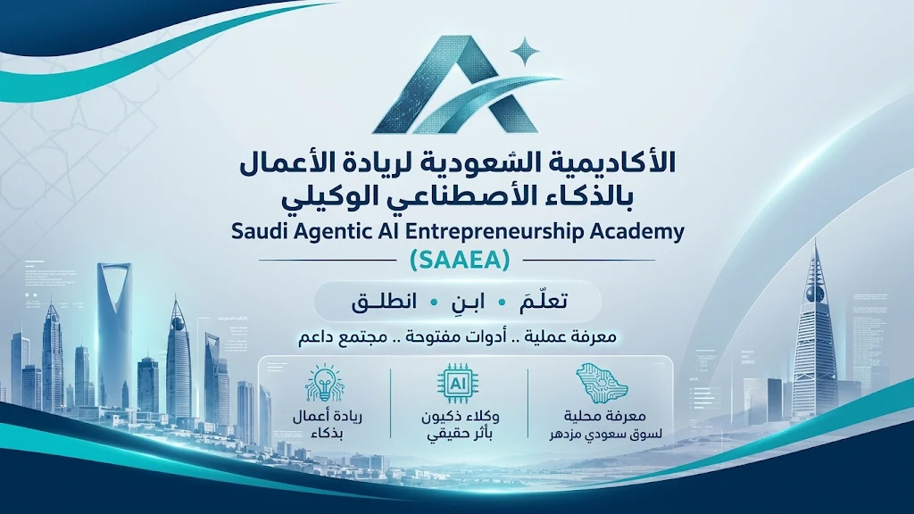

# Saudi Agentic AI Entrepreneurship Academy (SAAEA)

**الأكاديمية السعودية لريادة الأعمال بالذكاء الاصطناعي الوكيلي** · [العربية](README.md)

> Think like an entrepreneur, build like an AI engineer, operate like an agent-native company.

An open-source, Arabic-first reference for anyone who wants to start, run or grow a business in Saudi Arabia built on agentic AI. A personal initiative founded and maintained by **Prof. Mamdouh Alenezi**, developed with community contributions.

**Status:** v0.3 · Last reviewed: 17 November 2026

---

## 🤝 Every contribution is welcome

This academy is built in the open, in iterations, and it belongs to the people who contribute to it. **You do not need to be a programmer or an expert.** A typo fix, an updated link, a question that exposes a gap, an experience from your own business, a translated paragraph or a full guide: all are welcome and all are credited.

- Not sure where to start? Pick any item marked ☐ or ◻ in the [Saudi Market Knowledge Framework](02-saudi-market-knowledge-framework/README.md).
- Not comfortable with Git? Open an issue and write what you have in any form. We will do the rest.
- Not sure it is good enough? Send it anyway. We will review it with you.

Details in [CONTRIBUTING.md](CONTRIBUTING.md).

---

## What is available now

| Section | Contents | Status |
|---|---|---|
| [**Saudi Market Knowledge Framework**](02-saudi-market-knowledge-framework/README.md) | Twelve domains: establishment, AI regulation, data, cybersecurity, tax, funding, IP, e-commerce, employment, sectors, market intelligence, government procurement. With a regulatory register, a compliance checklist and a toolkit | **Available and growing** |
| [Founder Toolkit](04-entrepreneur-toolkit/README.md) | Ten bilingual business templates and a unit-economics calculator | Available |
| [Agentic AI Lab](05-agentic-ai-lab/README.md) | Ten entrepreneurial skills, five agent templates, an evaluation template, an Arabic model guide | Available |
| [Academy](01-academy/) | Vision and mission, learning framework, competency framework | Available |
| [Courses](03-courses/README.md) | Four courses | [Course 1](03-courses/01-opportunity/syllabus.md): **first content release available** (lessons, sector briefs, templates, rubrics). Courses 2 to 4 are draft outlines |
| [Case studies](06-case-studies/README.md) | Nine real cases from public sources (three Saudi) with evidence levels, scenarios and a learner worksheet | Available; owner-written cases wanted |
| [Learning pathways](01-academy/learning-pathways.md) · [Lab exercises](05-agentic-ai-lab/exercises/README.md) | A route for each kind of learner, and twelve hands-on exercises that use the two companion repositories | Available; exercises not yet tried with learners |
| [Resources](07-resources/README.md) · [Community](08-community/README.md) | Curated references; project showcase | Available |

## Companion repositories

The Academy is one of three independent repositories by the same author. Each works on its own.

| Repository | Job |
|---|---|
| **Academy** | Curriculum and Saudi market knowledge |
| [**Riyada**](https://github.com/malenezi/riyada) | Skills, context files and templates for founders who build and run a company with AI agents |
| [**Bayan**](https://github.com/malenezi/bayan) | Skills and linters for correct Arabic websites, decks and interface text |

We link and do not copy. Details and a "which one do I use" table: [companion repositories](07-resources/companion-repositories.md).

## Why this academy

- **From opportunity to revenue.** A pathway from a real problem inside a Saudi business to a working agent and a paying customer.
- **Arabic first.** Content, models and examples in Modern Standard Arabic and Saudi dialect.
- **Local in substance.** Regulation, funding and sectors as they are in the Kingdom, each with a source and a review date.
- **Measured by outcomes.** Opportunities validated and products launched, not certificates issued.

GASTAT reports that 33.1% of establishments in the Kingdom used AI technologies in 2025, which leaves roughly two thirds yet to start. See [SOURCES.md](SOURCES.md).

## Start in an hour

1. Fill in the [Startup Idea Canvas](04-entrepreneur-toolkit/01-startup-idea-canvas.md).
2. Read the [Founder's Agentic Compliance Checklist](02-saudi-market-knowledge-framework/founder-compliance-checklist.md) to see what applies.
3. Paste the [Founder Context Template](04-entrepreneur-toolkit/10-founder-context-template.md) into your preferred AI assistant.
4. Run the [Regulatory Navigator](02-saudi-market-knowledge-framework/founder-agents/README.md) or one of the [entrepreneurial skills](05-agentic-ai-lab/skills/README.md) on your idea.

## Principles

1. **An entrepreneurship academy, not an AI academy.** Technology is the means.
2. **Stochastic reasoning, deterministic authorization.** Agents act within bounds; consequential decisions have explicit controls and human approval.
3. **No thin wrappers.** The moat is the workflow, the data and the integrations.
4. **Evaluate before you sell.**
5. **No number without a source**, and no rule presented as current before it is checked.
6. **Open to everyone.** Every contribution is received with respect.

## Licence

- Educational content: [CC BY 4.0](LICENSE-CONTENT.md)
- Code: [Apache-2.0](LICENSE)

## Disclaimer

An independent personal initiative. It does not represent, and is not endorsed by, any government or private entity. Regulatory content is for awareness and is not legal or tax advice; always check the official text and the competent authority.
