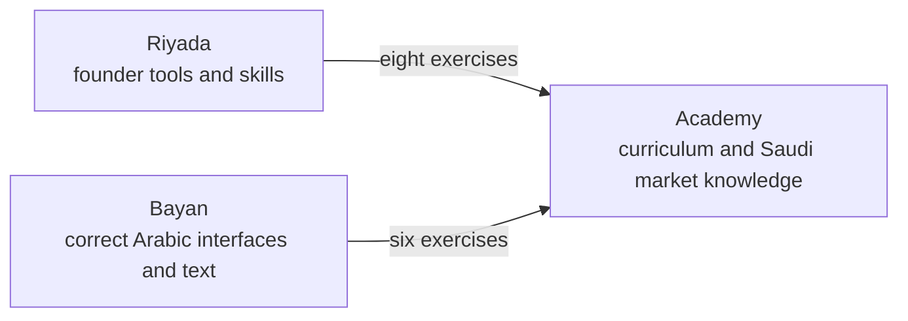

# Saudi Agentic AI Entrepreneurship Academy (SAAEA)

**الأكاديمية السعودية لريادة الأعمال بالذكاء الاصطناعي الوكيلي** · [العربية](README.md)

> Think like an entrepreneur, build like an AI engineer, operate like an agent-native company.

An open-source, Arabic-first knowledge initiative for anyone who wants to start, run or grow a business in Saudi Arabia built on agentic AI. It takes a founder from a real problem inside a Saudi business to a working agent and a paying customer, brings entrepreneurship, engineering, operations and governance into one pathway, and grounds its content in the Kingdom's regulatory and economic context. Founded and maintained by **Prof. Mamdouh Alenezi** as an independent personal initiative, and developed with community contributions.

**Status:** v0.10 ([changelog](CHANGELOG.md) · [roadmap](ROADMAP.md) · [release readiness](RELEASE-READINESS.md)) · Last reviewed: 21 November 2026

| First visit? | Want to see the slides? | Want to contribute? |
|---|---|---|
| [Start here](START-HERE.md#english): one page that points you to your route and answers the common questions | [Slide decks in the browser](https://malenezi.github.io/saudi-agentic-ai-entrepreneurship-academy/), and [every page on the site](https://malenezi.github.io/saudi-agentic-ai-entrepreneurship-academy/read.html?p=README.en.md) | [Contribute](#contribute): every contribution is welcome, and you do not need Git |

**Language.** Arabic is the Academy's primary language. Lessons are in Arabic with English terms and an English summary; syllabi, trainer guides, the completion standard and the labs' code are in English or in both.

---

## Contents

1. [Why this academy](#why-this-academy)
2. [Choose your route](#choose-your-route)
3. [Start in an hour](#start-in-an-hour)
4. [The four courses](#the-four-courses)
5. [What is available now](#what-is-available-now)
6. [Readiness](#readiness)
7. [Companion repositories](#companion-repositories)
8. [Contribute](#contribute)
9. [Principles](#principles)
10. [Repository structure](#repository-structure)
11. [Licence and citation](#licence-and-citation)
12. [Disclaimer](#disclaimer)

---

## Why this academy

- **From opportunity to revenue.** A pathway from a real problem inside a Saudi business to a working agent and a paying customer. The aim is ventures founded, products launched and revenue earned, not classroom training alone.
- **Arabic first.** Content, models and examples in Modern Standard Arabic and Saudi dialect, with the English term where it is needed.
- **Local in substance.** Regulation, funding and sectors as they are in the Kingdom, each fact with a source and a review date.
- **Four disciplines in one pathway.** Entrepreneurship, engineering, operations and governance.
- **Measured by outcomes.** Opportunities validated and products launched, not certificates issued.

**Why now?** GASTAT reports that 33.1% of establishments in the Kingdom used AI technologies in 2025, up from 27.6% in 2024, which leaves roughly two thirds yet to start.

Source: GASTAT, Establishments ICT Access and Usage Statistics 2025; entry A1 in the [source register](SOURCES.md). Reference year: 2025.

## Choose your route

| You are | Start with | Then |
|---|---|---|
| A first-time, non-technical founder | The [Founder Context Template](04-entrepreneur-toolkit/10-founder-context-template.md) | [Course 1](03-courses/01-opportunity/syllabus.md) on the core track |
| An SME owner | The [AI Opportunity Assessment](04-entrepreneur-toolkit/02-ai-opportunity-assessment.md) on your own operations | [Module 1.4](03-courses/01-opportunity/lessons/1-4-workflow-shadowing.md), then the [founder compliance checklist](02-saudi-market-knowledge-framework/founder-compliance-checklist.md) |
| A technical founder | [Course 1](03-courses/01-opportunity/syllabus.md), compressed | [Course 2](03-courses/02-build/syllabus.md) on the deep track |
| A student or freelancer | The [Founder Toolkit](04-entrepreneur-toolkit/README.md) | The courses in order, and the [case studies](06-case-studies/README.md) |
| A trainer, or an organisation running a cohort | The [programme trainer guide](03-courses/TRAINER-GUIDE.md) | The [fifteen-week instructor kit](01-academy/instructor-kit/README.md) and the [completion standard](03-courses/assessment-standard.md) |
| Only after the rules | The [Saudi Market Knowledge Framework](02-saudi-market-knowledge-framework/README.md) | The [regulatory register](02-saudi-market-knowledge-framework/regulatory-register.md) |

The full route for each kind of learner is in [learning pathways](01-academy/learning-pathways.md); self-paced learners have a [learner guide](03-courses/LEARNER-GUIDE.md).

## Start in an hour

1. Fill in the [Startup Idea Canvas](04-entrepreneur-toolkit/01-startup-idea-canvas.md).
2. Read the [founder compliance checklist](02-saudi-market-knowledge-framework/founder-compliance-checklist.md) to see what applies to you.
3. Paste the [Founder Context Template](04-entrepreneur-toolkit/10-founder-context-template.md) into your preferred AI assistant.
4. Run the [Regulatory Navigator](02-saudi-market-knowledge-framework/founder-agents/README.md#reference-agent-saudi-regulatory-navigator), another of the [founder agents](02-saudi-market-knowledge-framework/founder-agents/README.md) or one of the [entrepreneurial skills](05-agentic-ai-lab/skills/README.md) on your idea.

## The four courses

Four sequential courses, 76 hours, on two tracks: a low-code core track and a deep track for those who code. Each course ends in a business deliverable graded on evidence.

| # | Course | Question | Hours | Level | Deliverable |
|---|---|---|---|---|---|
| 1 | [Finding Your Agentic Opportunity](03-courses/01-opportunity/syllabus.md) | Which problem? | 16 | Beginner | Opportunity thesis |
| 2 | [Building AI Agents](03-courses/02-build/syllabus.md) | Does it work? | 24 | Beginner to intermediate | A working, evaluated agent |
| 3 | [Launch and Business Model](03-courses/03-launch/syllabus.md) | Will they pay? | 20 | Intermediate | Launch pack and a pilot with a customer |
| 4 | [Scale and Govern](03-courses/04-scale-and-govern/syllabus.md) | Can it grow safely? | 16 | Advanced | Scale pack and an investor pitch |

### Status of each course

| Course | Lessons | Decks | Quizzes | Practice material | Status | Not yet tested |
|---|---|---|---|---|---|---|
| Course 1 | 7 | 7 | 7 | Sector briefs, templates, interview records, a sample thesis, rubrics | **First content release available** | Not piloted with a cohort |
| Course 2 | 8 | 8 | 8 | Templates, a worked example, rubrics, [eight labs](03-courses/02-build/labs/README.md) that run with no key and at no cost, and a [low-code lab](03-courses/02-build/labs/lab-n8n-low-code.md) | **First content release available** | Not piloted with a cohort |
| Course 3 | 7 | 7 | 7 | Templates, a worked example, rubrics | **First content release available** | Not piloted with a cohort; Modules 3.4 and 3.7 have had no specialist review |
| Course 4 | 6 | 6 | 6 | Templates, a worked example, rubrics | **First content release available** | Not piloted with a cohort; Modules 4.3 and 4.4 have had no specialist review |

Every course has a glossary and an instructor guide. Details are in the [courses index](03-courses/README.md).

### Programme guides

| For | Guide |
|---|---|
| Learners | [Learner guide](03-courses/LEARNER-GUIDE.md) |
| Trainers | [Programme trainer guide](03-courses/TRAINER-GUIDE.md) and the [fifteen-week kit](01-academy/instructor-kit/README.md) |
| Assessors | [Completion standard](03-courses/assessment-standard.md) and the [outcomes-to-assessment alignment](03-courses/alignment.md) |
| Specialist reviewers, or an organisation piloting a cohort | [Review packets and pilot protocol](03-courses/validation/README.md) |

## What is available now

| Area | Outputs | Readiness |
|---|---|---|
| [**Saudi Market Knowledge Framework**](02-saudi-market-knowledge-framework/README.md) | Twelve domains: establishment, AI regulation, data, cybersecurity, tax, funding, IP, e-commerce, employment, sectors, market intelligence, government procurement. With a [regulatory register](02-saudi-market-knowledge-framework/regulatory-register.md), a [compliance checklist](02-saudi-market-knowledge-framework/founder-compliance-checklist.md) and a [compliance toolkit](02-saudi-market-knowledge-framework/compliance-toolkit/) | **Available and growing** |
| [Courses](03-courses/README.md) | Four courses: 28 lessons, each with a deck and a quiz, plus templates, worked examples and rubrics ([details above](#status-of-each-course)) | First content release available; not piloted with a cohort |
| [Founder Toolkit](04-entrepreneur-toolkit/README.md) | Thirteen bilingual business templates and three calculators: cost per resolved task, first-customers funnel, dilution | Available |
| [Agentic AI Lab](05-agentic-ai-lab/README.md) | Twelve [entrepreneurial skills](05-agentic-ai-lab/skills/README.md), five agent templates, an evaluation template, an Arabic model guide | Available |
| [Founder agents](02-saudi-market-knowledge-framework/founder-agents/README.md) | Twelve agents: a definition to paste into any assistant, the pages it reads, and three test conversations each | Available; eleven agents have one recorded run each with one assistant, not tried with founders |
| [Runnable agent templates](05-agentic-ai-lab/agent-templates/workflows/README.md) | Five files that import into n8n and run with a simulated model and no key, enforcing the oversight table in code | Available; not run with a real model, no channel connected |
| [Lab exercises](05-agentic-ai-lab/exercises/README.md) | Seventeen hands-on exercises: fourteen use the two companion repositories, three use the Academy's own skills | Available; not yet tried with learners |
| [Case studies](06-case-studies/README.md) | Nine real cases from public sources (three Saudi) with evidence levels, scenarios and a learner worksheet; plus twelve sourced venture journeys: funding, platforms, exits, and five Saudi companies building for agents | Available; owner-written cases wanted |
| [Learning pathways](01-academy/learning-pathways.md) | A route for each kind of learner, an [instructor kit](01-academy/instructor-kit/README.md) for a 15-week course, and a [venture workbook](workbook/index.html) | Available; not yet tried with learners |
| [Academy](01-academy/) | [Vision and mission](01-academy/vision-and-mission.md), [learning framework](01-academy/learning-framework.md), [competency framework](01-academy/competency-framework.md) | Available |
| [Resources](07-resources/README.md) · [Community](08-community/README.md) | Curated references; project showcase | Available |

## Readiness

We describe what exists as it is. The status of every item and the results of every check are in the [release-readiness report](RELEASE-READINESS.md) and the [QA report](03-courses/QA-REPORT.md).

| Available to use | In progress | Not yet tested |
|---|---|---|
| First content of all four courses | Restoring what was removed from the register and the funding directory, once verified at its source | No course has been piloted with a cohort |
| Knowledge framework: at least one published guide in every domain | Five newer guides rest on limited sources: IP, e-commerce, employment, sectors, government procurement | No lawyer, tax adviser or security specialist has reviewed the regulatory content |
| Founder Toolkit, lab and case studies | Saudi cases written by their owners | The exercises, the workbook and the instructor kit have not been tried with learners |
| Course 2 labs with a tested reference implementation | English versions of the lessons: lessons are in Arabic with English terms and an English summary | The completion standard has not been applied to a cohort |
| The twelve founder agents and the five runnable agent templates | An evaluation set from real Saudi-dialect messages | The test conversations of agents 2 to 12 were recorded once with one assistant (21 November 2026); no founder has used one |
| Automated link checks and tests on every change | Connecting the runnable templates to real channels and systems | The instructions of the templates and the low-code lab were run once with a real language model outside n8n (21 November 2026); no local model and no run through the HTTP node yet |

What comes next, and in what order, is in the [roadmap](ROADMAP.md).

## Companion repositories

The Academy is one of three independent repositories by the same author. Each works on its own, and they complement one another:

| Repository | Job | Answers |
|---|---|---|
| **Academy** (this repository) | Curriculum and Saudi market knowledge | What do I learn, in what order, and what are the rules in the Kingdom? |
| [**Riyada**](https://github.com/malenezi/riyada) | Skills, context files and templates for founders who build and run a company with AI agents | How do I do the founder's work itself with an agent? |
| [**Bayan**](https://github.com/malenezi/bayan) | Skills and linters for correct Arabic websites, decks and interface text | How does what I build come out in correct Arabic, in direction and in wording? |

**We link and do not copy.** What is specific to the Kingdom lives in the Academy, general founder tooling in Riyada, and Arabic interface correctness in Bayan. Both are optional: the courses are complete without them. The "which one do I use" table and the integration details are in [companion repositories](07-resources/companion-repositories.md).

## Contribute

This academy is built in the open, in iterations, and it belongs to the people who contribute to it. **You do not need to be a programmer or an expert.** A typo fix, an updated link, a question that exposes a gap, an experience from your own business, a translated paragraph or a full guide: all are welcome and all are credited.

### Three steps

**1. Pick a contribution that fits your time**

| Time | Contribution |
|---|---|
| A minute | Fix a typo or a broken link |
| 5 minutes | A question or a note: "this is unclear" or "this is missing" |
| 20 minutes | Verify an item from the [removal record](02-saudi-market-knowledge-framework/not-adopted.md) at its official source |
| An hour | An experience from your own business, or Saudi-dialect test cases for an agent |
| A few hours to a week | A guide in one of the domains, or a real case study |

Not sure where to start? Pick an item from the [list of what was removed as unverified](02-saudi-market-knowledge-framework/not-adopted.md) and verify it at its official page.

**2. Send it the way that is easiest for you**

- **Without Git:** [open an issue](https://github.com/malenezi/saudi-agentic-ai-entrepreneurship-academy/issues/new/choose) and write what you have in any form, in Arabic or English. We will do the rest.
- **A quick edit:** open the file on GitHub, press the edit button and propose your change.
- **A pull request:** fork the repository, make your change, run `make check`, and open the request.

**3. We review it with you and credit you**

Every contribution is received with respect and answered. We help you complete a missing source, format or translation, and we add your name to the contributors' record if you wish. Not sure it is good enough? Send it anyway.

### Where help matters most right now

- A legal, tax or security specialist to review one of the [review packets](03-courses/validation/README.md).
- An organisation to pilot a course with a cohort, following the [pilot protocol](03-courses/validation/pilot-protocol.md).
- Verifying what was removed from the register and the funding directory, and adding the amounts and conditions that programme pages leave out.
- Practitioner-written guides for tax, IP, employment and government procurement.
- Real Saudi case studies written by their owners.

Details and conditions are in [CONTRIBUTING.md](CONTRIBUTING.md) and the [code of conduct](CODE_OF_CONDUCT.md).

## Principles

1. **An entrepreneurship academy, not an AI academy.** AI is a means of enabling entrepreneurship, not an end in itself.
2. **Stochastic reasoning, deterministic authorization.** An agent proposes and acts within set bounds; consequential decisions stay under explicit controls and human approval.
3. **No thin wrappers.** The advantage is in the workflow design, the data and the integrations, not in wrapping an existing model.
4. **Validate before you sell.** Prove the need, the feasibility and the value before you build and market the solution.
5. **No number without a source.** And no law, regulation or requirement is presented as current before its currency and force are checked.
6. **Knowledge is open to everyone.** Every contribution and idea is welcome and received with respect.

## Repository structure

| Path | Contents |
|---|---|
| [`01-academy/`](01-academy/) | Vision and mission, learning framework, competency framework, learning pathways, instructor kit |
| [`02-saudi-market-knowledge-framework/`](02-saudi-market-knowledge-framework/README.md) | The twelve domains, the regulatory register, the [official directory](02-saudi-market-knowledge-framework/official-directory.md), the compliance toolkit, founder agents |
| [`03-courses/`](03-courses/README.md) | The four courses, their guides, the completion standard and the validation files |
| [`04-entrepreneur-toolkit/`](04-entrepreneur-toolkit/README.md) | Founder templates and calculators |
| [`05-agentic-ai-lab/`](05-agentic-ai-lab/README.md) | Skills, agent templates, evaluation, exercises |
| [`06-case-studies/`](06-case-studies/README.md) | Case studies and venture journeys |
| [`07-resources/`](07-resources/README.md) | References, and the companion repositories |
| [`08-community/`](08-community/README.md) | Participation and the project showcase |
| [`workbook/`](workbook/index.html) | The venture workbook |
| `tools/` · `tests/` | Build and checking tools and their tests; `make check` runs them all |
| [`SOURCES.md`](SOURCES.md) | The source register: every external fact with its source and the date it was checked |

## Licence and citation

- Educational content: [CC BY 4.0](LICENSE-CONTENT.md)
- Code: [Apache-2.0](LICENSE)
- Third-party material: [THIRD-PARTY.md](THIRD-PARTY.md)
- To cite the Academy: [CITATION.cff](CITATION.cff) · To report a security issue: [SECURITY.md](SECURITY.md)

## Disclaimer

An independent personal initiative. It does not represent, and is not endorsed by, any government or private entity. Regulatory content is for awareness and is not legal or tax advice; always check the official text and the competent authority.
