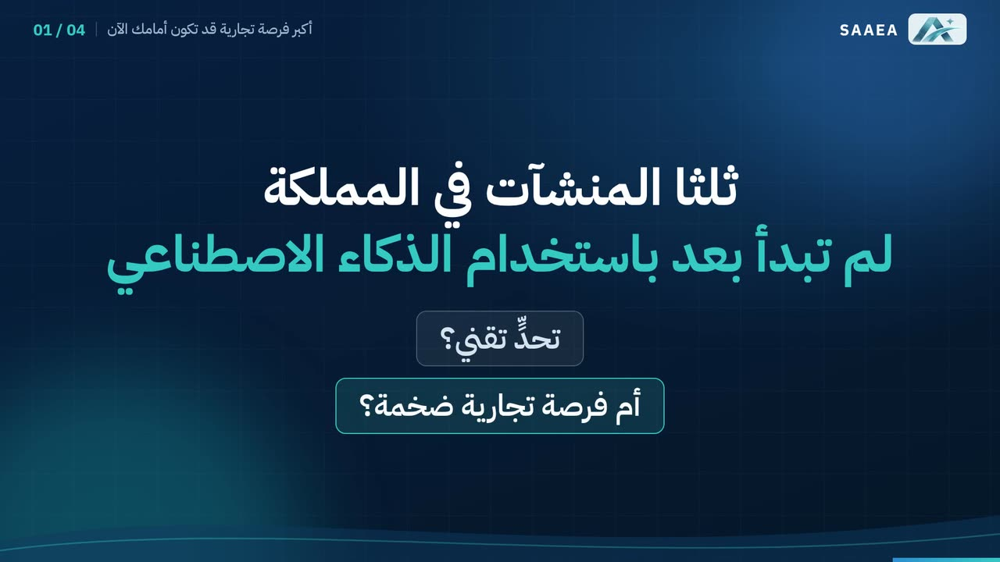
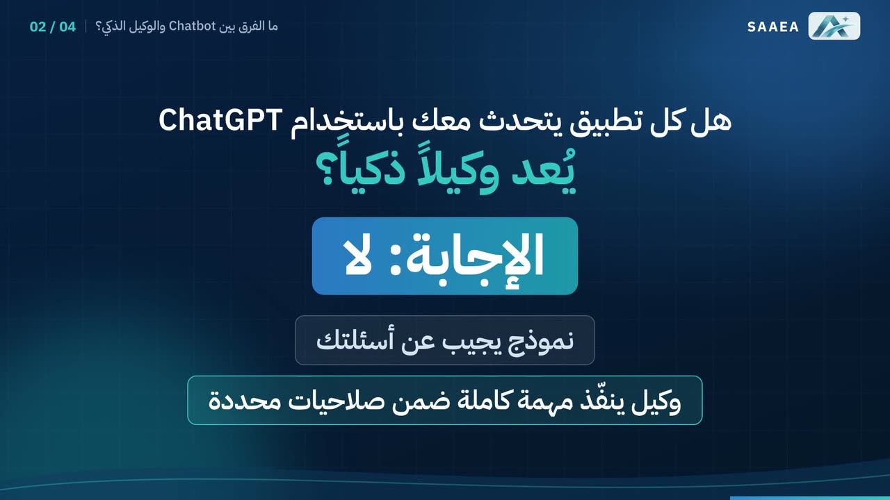
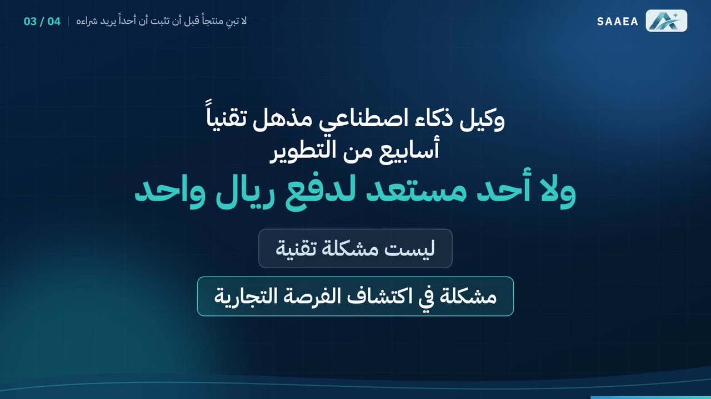
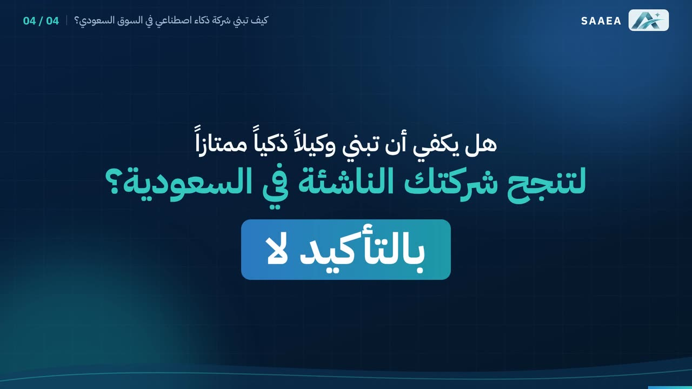
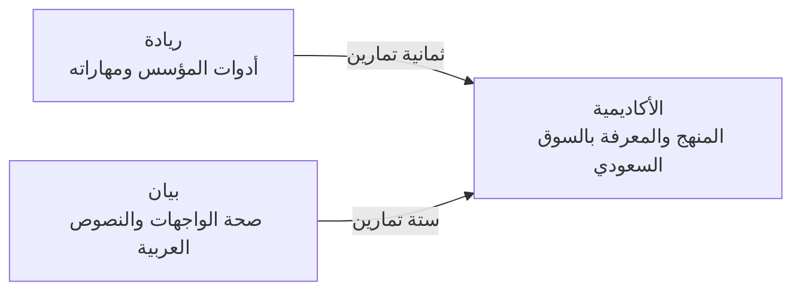

<p align="center"></p>

<div dir="rtl">

# الأكاديمية السعودية لريادة الأعمال بالذكاء الاصطناعي الوكيلي

**Saudi Agentic AI Entrepreneurship Academy (SAAEA)** · [English](README.en.md)

> أكاديمية سعودية مفتوحة لتمكين رواد الأعمال والمطورين من اكتشاف الفرص التجارية، وتصميم حلول الذكاء الاصطناعي القائمة على الوكلاء (Agentic AI) وبنائها، وإطلاق منتجات قابلة للتشغيل والتوسع في السوق السعودي.

تشير بيانات الهيئة العامة للإحصاء لعام 2025 إلى أن نحو ثلثي المنشآت في المملكة لم تبدأ بعد في توظيف تقنيات الذكاء الاصطناعي. وفي المقابل، يغلب على المحتوى المتاح لمن يسعى إلى تطوير حلول تخدم هذه المنشآت الطابع العام واللغة الإنجليزية، دون مراعاة كافية للأنظمة والسياق المحلي في المملكة.

من هنا جاءت الأكاديمية السعودية لريادة الأعمال بالذكاء الاصطناعي الوكيلي مبادرةً معرفية مجانية، محتواها باللغة العربية أساساً، مع المصطلحات الإنجليزية عند الحاجة. تأخذ رواد الأعمال والمطورين من تحديد مشكلة حقيقية لدى منشأة في المملكة إلى تطوير وكيل ذكي قابل للتشغيل، ثم تحويله إلى منتج ذي قيمة تجارية.

**المسار الرئيس: [رحلة المشروع](journey/README.md).** اثنا عشر أسبوعاً بأربع مراحل، يُحسم التقدم فيها عند ثلاث بوابات تُجتاز بالدليل:

| المرحلة | ما تخرج به | البوابة |
|---|---|---|
| [1. اكتشف](journey/1-find.md) | مشكلة تقبل منشأة بعينها أن تدفع لحلها | دليل المشكلة |
| [2. ابنِ](journey/2-build.md) | وكيل يؤدي العمل الفعلي إلى جانب الموظفين | وكيل في وضع الظل داخل منشأة حقيقية |
| [3. بِع](journey/3-sell.md) | تجربة مدفوعة بشروط موقّعة | منشأة دفعت |
| [4. شغّل](journey/4-operate.md) | عميل مستمر، أو وفر مَقيس | متابعة اليوم 180 |

**بمَ تُقاس الأكاديمية:** بـ[سجل الأثر](impact/README.md): مشكلات تحقّق منها المشاركون، ووكلاء يعملون في منشآت حقيقية، وعملاء يدفعون. **الأرقام اليوم كلها أصفار:** لم يبدأ أي فوج بعد، ويُخطَّط للأول بعد عيد الفطر 1448هـ (2027). والمحتوى [مجمَّد](ROADMAP.md#content-freeze-26-november-2026) إلى أن يُنجَز.

وفي المستودع ما تستند إليه الرحلة:

- **4 مقررات تعليمية، و28 درساً، بإجمالي 76 ساعة تدريبية**، لكل درس عرض تقديمي واختبار قصير، في مسارين: مسار أساسي للتطوير منخفض البرمجة (Low-Code)، ومسار عميق للمبرمجين.
- **إطاراً معرفياً للسوق السعودي** يغطي 12 مجالاً، مع توثيق مصدر كل معلومة وتاريخ التحقق منها.
- **12 وكيلاً ذكياً مساعداً لرواد الأعمال**، يُضاف تعريف كل منها إلى أي مساعد ذكي.
- **14 قالباً ثنائي اللغة (العربية والإنجليزية)، و4 حاسبات** لدعم مراحل تأسيس المشروع وتطويره.
- **8 مختبرات تطبيقية** تعمل مباشرة دون مفتاح API ودون تكلفة تشغيلية.

**الجاهزية والشفافية:** لم تخضع الأكاديمية للاختبار مع فوج فعلي من المتدربين حتى الآن، ولم يخضع محتواها لمراجعة قانونية متخصصة. ونفصح عن ذلك بوضوح لأنه جزء من تقييم جاهزيتها ([تقرير الجاهزية](RELEASE-READINESS.md)).

**جرّبها في دقيقة واحدة:** ثلاثة أوامر فقط، باستخدام Python 3.9 أو إصدار أحدث، ودون تثبيت أي حزم إضافية.

</div>

```bash
git clone https://github.com/malenezi/saudi-agentic-ai-entrepreneurship-academy.git
cd saudi-agentic-ai-entrepreneurship-academy/03-courses/02-build/labs/reference
python3 -m order_agent.cli "ما حالة طلبي رقم 84522؟"
```

<div dir="rtl">

يبحث الوكيل عن الطلب ويصوغ الرد. وإن كنت لا تبرمج، [فابدأ خلال ساعة](#ابدأ-خلال-ساعة) أو [افتح العروض التقديمية](https://malenezi.github.io/saudi-agentic-ai-entrepreneurship-academy/).

أسّسها ويشرف عليها **أ.د. ممدوح العنزي** مبادرةً شخصية مستقلة، وتتطور بمساهمات المجتمع.

**الحالة:** الإصدار 0.14، والمحتوى مجمَّد إلى أن يُنجَز أول فوج ([السبب](ROADMAP.md#content-freeze-26-november-2026)) ([سجل التغييرات](CHANGELOG.md) · [خارطة الطريق](ROADMAP.md) · [جاهزية الإصدار](RELEASE-READINESS.md)) · آخر مراجعة: 26 نوفمبر 2026

| زيارتك الأولى؟ | تريد مشاهدة العروض؟ | تريد المساهمة؟ |
|---|---|---|
| [ابدأ من هنا](START-HERE.md): صفحة واحدة ترشدك إلى مسارك، وتجيب عن الأسئلة الشائعة | [العروض التقديمية في المتصفح](https://malenezi.github.io/saudi-agentic-ai-entrepreneurship-academy/)، و[المحتوى كله صفحاتٍ على الموقع](https://malenezi.github.io/saudi-agentic-ai-entrepreneurship-academy/read.html?p=START-HERE.md) | [ساهم معنا](#ساهم-معنا): كل مساهمة مرحَّب بها، ولا تحتاج إلى Git |

---

## شاهد: من الفرصة إلى المشروع

أربعة فيديوهات قصيرة، في كل منها معرفة قابلة للتطبيق. اضغط الصورة للمشاهدة، أو [شاهدها كلها في صفحة الأكاديمية](https://malenezi.github.io/saudi-agentic-ai-entrepreneurship-academy/#h-videos).

| [](https://malenezi.github.io/saudi-agentic-ai-entrepreneurship-academy/assets/videos/01-opportunity.mp4) | [](https://malenezi.github.io/saudi-agentic-ai-entrepreneurship-academy/assets/videos/02-chatbot-vs-agent.mp4) | [](https://malenezi.github.io/saudi-agentic-ai-entrepreneurship-academy/assets/videos/03-validate-before-build.mp4) | [](https://malenezi.github.io/saudi-agentic-ai-entrepreneurship-academy/assets/videos/04-saudi-market.mp4) |
|---|---|---|---|
| **1. أكبر فرصة تجارية قد تكون أمامك الآن** · <bdi dir="ltr">1:36</bdi> | **2. ما الفرق بين Chatbot والوكيل الذكي؟** · <bdi dir="ltr">1:31</bdi> | **3. لا تبنِ منتجاً قبل أن تثبت أن أحداً يريد شراءه** · <bdi dir="ltr">1:35</bdi> | **4. كيف تبني شركة ذكاء اصطناعي في السوق السعودي؟** · <bdi dir="ltr">1:48</bdi> |

رسوم حركية وتعليق بصوت اصطناعي وموسيقى مولّدة؛ لا مشاهد مصوّرة. [نصوص التعليق](assets/videos/transcripts.md) · [كيف صُنعت وما حدودها](assets/videos/README.md)

## لماذا هذه الأكاديمية

- **من الفرصة إلى الإيراد:** مسار يبدأ بمشكلة حقيقية لدى منشأة في المملكة، وينتهي بوكيل ذكي قابل للتشغيل ومنتج ذي قيمة تجارية. الغاية تأسيس المشاريع وإطلاق المنتجات وتحقيق الإيرادات، لا التدريب النظري وحده.
- **المحتوى باللغة العربية أساساً:** دروس ونماذج وأمثلة بالعربية الفصحى واللهجة السعودية، مع المصطلحات الإنجليزية عند الحاجة.
- **سياق المملكة:** الأنظمة والتمويل والقطاعات كما هي في المملكة، ولكل معلومة مصدر وتاريخ تحقق.
- **أربعة ميادين في مسار واحد:** ريادة الأعمال، والهندسة، والتشغيل، والحوكمة.
- **مقياس النجاح:** فرص جرى التحقق منها ومنتجات أُطلقت، لا عدد الشهادات.

**لماذا الآن؟** وفق الهيئة العامة للإحصاء، استخدمت 33.1% من المنشآت في المملكة تقنيات الذكاء الاصطناعي في عام 2025، ارتفاعاً من 27.6% في عام 2024؛ أي أن نحو ثلثي المنشآت لم تبدأ بعد. ونسبة عام 2024 منقولة عن «عرب نيوز» من نشرة ذلك العام، ولا تذكرها نشرة 2025.

<sub>المصدر: «إحصاءات نفاذ واستخدام تقنية المعلومات والاتصالات للمنشآت 2025»، الهيئة العامة للإحصاء؛ البند A1 في [سجل المصادر](SOURCES.md). سنة القياس: 2025.</sub>

## اختر مسارك

| من أنت؟ | ابدأ بـ | ثم |
|---|---|---|
| رائد أعمال غير تقني في مشروعه الأول | [قالب سياق المؤسس](04-entrepreneur-toolkit/10-founder-context-template.md) | [المقرر 1](03-courses/01-opportunity/syllabus.md) بالمسار الأساسي |
| صاحب منشأة صغيرة أو متوسطة | [تقييم فرص الوكلاء](04-entrepreneur-toolkit/02-ai-opportunity-assessment.md) مطبَّقاً على عمليات منشأتك | [الوحدة 1.4](03-courses/01-opportunity/lessons/1-4-workflow-shadowing.md)، ثم [قائمة الامتثال للمؤسس](02-saudi-market-knowledge-framework/founder-compliance-checklist.md) |
| مؤسس تقني | [المقرر 1](03-courses/01-opportunity/syllabus.md) مكثفاً | [المقرر 2](03-courses/02-build/syllabus.md) بالمسار العميق |
| طالب أو مستقل | [حقيبة المؤسس](04-entrepreneur-toolkit/README.md) | المقررات بالترتيب، و[دراسات الحالة](06-case-studies/README.md) |
| مدرب، أو جهة تشغّل فوجاً | [دليل المدرب للبرنامج](03-courses/TRAINER-GUIDE.md) | [حقيبة المدرّس لخمسة عشر أسبوعاً](01-academy/instructor-kit/README.md) و[معيار الإتمام](03-courses/assessment-standard.md) |
| باحث عن الأنظمة والمتطلبات فقط | [إطار المعرفة بالسوق السعودي](02-saudi-market-knowledge-framework/README.md) | [السجل التنظيمي](02-saudi-market-knowledge-framework/regulatory-register.md) |

المسار الكامل لكل فئة من المتعلمين في [مسارات التعلّم](01-academy/learning-pathways.md)، وللمتعلم الذاتي [دليل المتعلم](03-courses/LEARNER-GUIDE.md).

## ابدأ خلال ساعة

1. املأ [لوحة فكرة المشروع](04-entrepreneur-toolkit/01-startup-idea-canvas.md).
2. راجع [قائمة الامتثال للمؤسس](02-saudi-market-knowledge-framework/founder-compliance-checklist.md) لتعرف المتطلبات النظامية التي تنتظرك.
3. انسخ [قالب سياق المؤسس](04-entrepreneur-toolkit/10-founder-context-template.md) إلى مساعدك الذكي المفضل.
4. شغّل [المرشد التنظيمي](02-saudi-market-knowledge-framework/founder-agents/README.md#reference-agent-saudi-regulatory-navigator) أو أحد [وكلاء المؤسس](02-saudi-market-knowledge-framework/founder-agents/README.md) أو إحدى [المهارات الريادية](05-agentic-ai-lab/skills/README.md) على فكرتك.

## المقررات الأربعة

أربعة مقررات متتابعة في 76 ساعة تدريبية، بمسارين: مسار أساسي للتطوير منخفض البرمجة (Low-Code)، ومسار عميق لمن يبرمج. ينتهي كل مقرر بمُخرَج تجاري يُقيَّم بالدليل.

| # | المقرر | السؤال | الساعات | المستوى | المُخرَج |
|---|---|---|---|---|---|
| 1 | [اكتشاف الفرصة الوكيلية](03-courses/01-opportunity/syllabus.md) | أي مشكلة تستحق الحل؟ | 16 | مبتدئ | أطروحة الفرصة |
| 2 | [بناء الوكلاء الأذكياء](03-courses/02-build/syllabus.md) | هل يعمل الوكيل؟ | 24 | مبتدئ إلى متوسط | وكيل ذكي قابل للتشغيل ومُقيَّم |
| 3 | [الإطلاق وبناء النموذج التجاري](03-courses/03-launch/syllabus.md) | هل يدفع العميل؟ | 20 | متوسط | حزمة الإطلاق وتجربة مع عميل |
| 4 | [التوسع والحوكمة](03-courses/04-scale-and-govern/syllabus.md) | هل ينمو المشروع بأمان؟ | 16 | متقدم | حزمة التوسع وعرض استثماري |

### حالة كل مقرر

| المقرر | الدروس | العروض | الاختبارات القصيرة | مواد التطبيق | الحالة | ما لم يخضع للاختبار حتى الآن |
|---|---|---|---|---|---|---|
| المقرر 1 | 7 | 7 | 7 | موجزات قطاعية، قوالب، سجلات مقابلات، أطروحة نموذجية، سلالم تقدير | **الإصدار الأول من المحتوى متاح** | لم يخضع لتجربة تدريبية فعلية |
| المقرر 2 | 8 | 8 | 8 | قوالب، مثال محلول، سلالم تقدير، و[ثمانية مختبرات](03-courses/02-build/labs/README.md) تعمل دون مفتاح ودون تكلفة، و[مختبر للتطوير منخفض البرمجة](03-courses/02-build/labs/lab-n8n-low-code.md) | **الإصدار الأول من المحتوى متاح** | لم يخضع لتجربة تدريبية فعلية |
| المقرر 3 | 7 | 7 | 7 | قوالب، مثال محلول، سلالم تقدير | **الإصدار الأول من المحتوى متاح** | لم يخضع لتجربة تدريبية فعلية؛ الوحدتان 3.4 و3.7 لم يراجعهما مختص |
| المقرر 4 | 6 | 6 | 6 | قوالب، مثال محلول، سلالم تقدير | **الإصدار الأول من المحتوى متاح** | لم يخضع لتجربة تدريبية فعلية؛ الوحدتان 4.3 و4.4 لم يراجعهما مختص |

لكل مقرر مسرد ودليل مدرب. والتفاصيل في [فهرس المقررات](03-courses/README.md).

### أدلة البرنامج

| الفئة | الدليل |
|---|---|
| المتعلم | [دليل المتعلم](03-courses/LEARNER-GUIDE.md) |
| المدرب | [دليل المدرب للبرنامج](03-courses/TRAINER-GUIDE.md) و[حقيبة 15 أسبوعاً](01-academy/instructor-kit/README.md) |
| المقيّم | [معيار الإتمام](03-courses/assessment-standard.md) و[مصفوفة النواتج والتقييم](03-courses/alignment.md) |
| المراجع المختص، أو جهة تجرّب فوجاً | [حزم المراجعة وبروتوكول التجربة](03-courses/validation/README.md) |

## ما المتاح الآن

| المجال | المخرجات | الجاهزية |
|---|---|---|
| [**إطار المعرفة بالسوق السعودي**](02-saudi-market-knowledge-framework/README.md) | اثنا عشر مجالاً: التأسيس، تنظيم الذكاء الاصطناعي، البيانات، الأمن السيبراني، الضرائب، التمويل، الملكية الفكرية، التجارة الإلكترونية، التوظيف، القطاعات، ذكاء السوق، المشتريات الحكومية. ومعها [سجل تنظيمي](02-saudi-market-knowledge-framework/regulatory-register.md) و[قائمة امتثال](02-saudi-market-knowledge-framework/founder-compliance-checklist.md) و[حقيبة أدوات](02-saudi-market-knowledge-framework/compliance-toolkit/) | **متاح، ويتوسع** |
| [المقررات](03-courses/README.md) | أربعة مقررات: 28 درساً، لكل منها عرض واختبار قصير، مع قوالب وأمثلة محلولة وسلالم تقدير ([التفصيل أعلاه](#حالة-كل-مقرر)) | الإصدار الأول من المحتوى متاح؛ لم يخضع لتجربة تدريبية فعلية حتى الآن |
| [حقيبة المؤسس](04-entrepreneur-toolkit/README.md) | أربعة عشر قالب أعمال ثنائي اللغة، وأربع حاسبات: تكلفة المهمة، العائد عند العميل، قمع العملاء، تخفيف الملكية | متاح |
| [مختبر الذكاء الاصطناعي الوكيلي](05-agentic-ai-lab/README.md) | اثنتا عشرة [مهارة ريادية](05-agentic-ai-lab/skills/README.md)، خمسة قوالب وكلاء، قالب تقييم، دليل النماذج العربية | متاح |
| [وكلاء المؤسس](02-saudi-market-knowledge-framework/founder-agents/README.md) | اثنا عشر وكيلاً: تعريف يُضاف إلى أي مساعد ذكي، والصفحات التي يقرأ منها، وثلاث محادثات اختبار لكل وكيل | متاح؛ سُجّلت محادثات اختبار أحد عشر وكيلاً مرة واحدة بمساعد واحد، ولم يُجرَّب مع مؤسسين |
| [قوالب الوكلاء القابلة للتشغيل](05-agentic-ai-lab/agent-templates/workflows/README.md) | خمسة ملفات تُستورد في n8n وتعمل بنموذج محاكٍ دون مفتاح، وتفرض جدول الإشراف بالشيفرة | متاح؛ شُغّلت تعليماتها ثلاث مرات مع نموذج لغوي خارج n8n، آخرها في 24 نوفمبر 2026 بالإصلاح والطلب الثاني ([النتائج](05-agentic-ai-lab/agent-templates/workflows/real-model-runs/README.md))، ولم تُجرَّب عبر عقدة HTTP ولم تُربط بقناة |
| [تمارين المختبر](05-agentic-ai-lab/exercises/README.md) | سبعة عشر تمريناً عملياً، منها أربعة عشر تستخدم المستودعين المرافقين | متاح؛ لم تُجرَّب مع متعلمين |
| [دراسات الحالة](06-case-studies/README.md) | خمس عشرة حالة تشغيل من مصادر منشورة (ثمانٍ منها سعودية) بمستويات دليل، وفهرس بحسب الموضوع والوحدة، وستة سيناريوهات وورقة عمل؛ واثنتان وعشرون صفحة شركات موثّقة: تمويل، منصات، تخارج، وعشر شركات سعودية تبني للوكلاء وخمس عالمية | متاح؛ ننتظر حالات يكتبها أصحابها |
| [مكتبة المنهجيات والنماذج](09-methodology-library/README.md) | بطاقة موحّدة لكل نموذج: النماذج الأساسية (التفكير التصميمي، لوحة نموذج العمل، معمارية الوكيل، تقييم الوكيل، اقتصاديات الوحدة، وغيرها)، ونماذج الأكاديمية الخاصة بالوكلاء مع ثلاثة قوالب جديدة (مصفوفة القدرات، مصفوفة الوصول إلى الأدوات، تقييم الجاهزية)، ونماذج المستوى التطبيقي (مخططات الفئات والتسلسل والكيانات وتدفق البيانات والمسارات، RAG، MCP، تنسيق الوكلاء، وغيرها) مع عشرة مخططات من رسم الأكاديمية. لكل بطاقة مصدر وقالب ومثال، والعدد الحالي وما يُكتب تباعاً في فهرس المكتبة | متاح؛ لم تُجرَّب البطاقات مع متدربين |
| [مسارات التعلّم](01-academy/learning-pathways.md) | مسار لكل فئة من المتعلمين، و[حقيبة مدرّس](01-academy/instructor-kit/README.md) لمقرر من 15 أسبوعاً، و[دفتر المشروع](workbook/index.html) | متاح؛ لم تُجرَّب مع متعلمين |
| [الأكاديمية](01-academy/) | [الرؤية والرسالة](01-academy/vision-and-mission.md)، [الإطار التعليمي](01-academy/learning-framework.md)، [إطار الكفايات](01-academy/competency-framework.md) | متاح |
| [المصادر](07-resources/README.md) · [المجتمع](08-community/README.md) | مراجع مختارة، معرض المشاريع | متاح |

## الجاهزية والشفافية

نعرض ما أُنجز كما هو، دون زيادة. حالة كل بند ونتائج الفحوص في [تقرير جاهزية الإصدار](RELEASE-READINESS.md) و[تقرير مراجعة الجودة](03-courses/QA-REPORT.md).

| متاح للاستخدام | جارٍ تطويره | لم يخضع للاختبار حتى الآن |
|---|---|---|
| المحتوى الأول للمقررات الأربعة | إعادة ما حُذف من السجل التنظيمي ودليل التمويل بعد توثيقه من مصدره | لم يُجرَّب أي مقرر مع فوج |
| إطار المعرفة: دليل منشور واحد على الأقل لكل مجال | خمسة أدلة جديدة مبنية على مصادر محدودة: الملكية الفكرية، التجارة الإلكترونية، التوظيف، القطاعات، المشتريات الحكومية | لم يراجع المحتوى التنظيمي محامٍ ولا مستشار ضريبي ولا مختص أمني |
| حقيبة المؤسس، والمختبر، ودراسات الحالة | حالات سعودية يكتبها أصحابها | لم تُجرَّب التمارين ولا دفتر المشروع ولا حقيبة المدرّس مع متعلمين |
| مختبرات المقرر 2 بشيفرة مرجعية مختبَرة | نسخ إنجليزية من الدروس: الدروس عربية بمصطلحات إنجليزية وملخص إنجليزي | معيار الإتمام لم يُطبَّق على فوج |
| وكلاء المؤسس الاثنا عشر، وقوالب الوكلاء الخمسة القابلة للتشغيل | مجموعة تقييم من رسائل حقيقية باللهجة السعودية | سُجّلت محادثات اختبار الوكلاء 2 إلى 12 مرة واحدة بمساعد واحد (21 نوفمبر 2026)، ولم يستخدمها مؤسس |
| فحص آلي للروابط واختبارات عند كل تعديل | ربط القوالب القابلة للتشغيل بقنوات وأنظمة حقيقية | شُغّلت تعليمات القوالب والمختبر مرة واحدة مع نموذج لغوي حقيقي خارج n8n (21 نوفمبر 2026)، ومرة مع نموذج محلي صغير على حاسب محمول (22 نوفمبر 2026: 38 من 47 حالة في القوالب)، ولم تُجرَّب عبر عقدة HTTP |

ما يُبنى لاحقاً وترتيبه في [خارطة الطريق](ROADMAP.md).

## المستودعات المرافقة

الأكاديمية واحد من ثلاثة مستودعات مستقلة لمؤسسها. يعمل كل منها مستقلاً، ويكمل بعضها بعضاً:

| المستودع | وظيفته | السؤال الذي يجيب عنه |
|---|---|---|
| **الأكاديمية** (هذا المستودع) | المنهج والمعرفة بالسوق السعودي | ماذا أتعلم، وبأي ترتيب، وما الأنظمة في المملكة؟ |
| [**ريادة**](https://github.com/malenezi/riyada) | مهارات وملفات سياق وقوالب لمؤسس يبني منشأته ويشغّلها بالوكلاء | كيف أنجز العمل الريادي نفسه بمعاونة وكيل؟ |
| [**بيان**](https://github.com/malenezi/bayan) | مهارات ومدققات لواجهات وعروض ونصوص عربية سليمة | كيف يخرج ما أبنيه بعربية سليمة اتجاهاً ونصاً؟ |



**نربط ولا ننسخ.** ما يخص المملكة موضعه الأكاديمية، والأدوات الريادية العامة موضعها «ريادة»، وسلامة العربية في الواجهات موضعها «بيان». والمستودعان اختياريان: تكتمل المقررات بدونهما. جدول «أيهما أستخدم» وتفاصيل الربط في [المستودعات المرافقة](07-resources/companion-repositories.md).

## ساهم معنا

تُبنى هذه الأكاديمية علناً وعلى مراحل، وهي ملك لمن يساهم فيها. **لا يُشترط أن تكون مبرمجاً ولا خبيراً لتساهم.** تصحيح خطأ إملائي، أو تحديث رابط، أو سؤال يكشف نقصاً، أو تجربة من عملك، أو ترجمة فقرة، أو دليل كامل: كلها مساهمات نرحّب بها ونشكر أصحابها.

### ثلاث خطوات

**1. اختر مساهمة تناسب وقتك**

| الوقت | المساهمة |
|---|---|
| دقيقة | تصحيح خطأ إملائي أو رابط معطّل |
| 5 دقائق | سؤال أو ملاحظة: «هذا غير واضح» أو «هذا ينقصه كذا» |
| 20 دقيقة | توثيق بند من [قائمة ما حُذف](02-saudi-market-knowledge-framework/not-adopted.md) من مصدره الرسمي |
| ساعة | تجربة من عملك، أو حالات اختبار باللهجة السعودية لوكيل |
| بضع ساعات إلى أسبوع | دليل في أحد المجالات، أو دراسة حالة حقيقية |

لا تعرف من أين تبدأ؟ اختر بنداً من [قائمة ما حُذف لعدم توثيقه](02-saudi-market-knowledge-framework/not-adopted.md) ووثّقه من صفحته الرسمية.

**2. أرسلها بالطريقة الأيسر لك**

- **دون Git:** [افتح Issue](https://github.com/malenezi/saudi-agentic-ai-entrepreneurship-academy/issues/new/choose) واكتب ما لديك بأي صيغة، بالعربية أو بالإنجليزية، ونحن نتولى الباقي.
- **تعديل سريع:** افتح الملف في GitHub واضغط زر التعديل، ثم أرسل اقتراحك.
- **طلب دمج (Pull Request):** انسخ المستودع، وعدّل، وشغّل `make check`، ثم افتح الطلب.

**3. نراجعها معك وننسبها إليك**

نستقبل كل مساهمة باحترام ونرد عليها، ونكمل معك ما ينقصها من مصدر أو تنسيق أو ترجمة، ونثبت اسمك في سجل المساهمين إن رغبت. وإن لم تكن متأكداً من جودة ما لديك، فأرسله على أي حال.

### أين تشتد الحاجة الآن

- مختص قانوني أو ضريبي أو أمني يراجع إحدى [حزم المراجعة](03-courses/validation/README.md).
- جهة تجرّب مقرراً مع فوج وفق [بروتوكول التجربة](03-courses/validation/pilot-protocol.md).
- توثيق ما حُذف من السجل التنظيمي ودليل التمويل، وإضافة ما لا تذكره صفحات البرامج من مبالغ وشروط.
- أدلة يكتبها ممارسون في الضرائب والملكية الفكرية والتوظيف والمشتريات الحكومية.
- دراسات حالة سعودية حقيقية يكتبها أصحابها.

التفاصيل والشروط في [دليل المساهمة](CONTRIBUTING.md) و[ميثاق السلوك](CODE_OF_CONDUCT.md).

## المبادئ

1. **أكاديمية لريادة الأعمال، لا للذكاء الاصطناعي.** الذكاء الاصطناعي وسيلة لتمكين الريادة، وليس غاية في ذاته.
2. **استدلال احتمالي، وصلاحيات حتمية.** يقترح الوكيل وينفّذ ضمن حدود مرسومة، وتبقى القرارات ذات الأثر الجوهري خاضعة لضوابط واضحة وموافقة بشرية صريحة.
3. **لا قيمة للغلاف التقني وحده.** الميزة التنافسية في تصميم سير العمل والبيانات والتكاملات، لا في تغليف نموذج قائم.
4. **تحقّق قبل أن تبيع.** أثبت الحاجة والجدوى والقيمة قبل أن تطوّر الحل وتسوّقه.
5. **لا معلومة رقمية دون مصدر موثوق وتاريخ تحقق.** ولا يُعرض نظام أو متطلب تنظيمي على أنه سارٍ قبل التحقق من حداثته ونفاذه.
6. **المعرفة مفتوحة للجميع.** نرحّب بكل مساهمة وفكرة، ونستقبلها باحترام وتقدير.

## بنية المستودع

| المسار | المحتوى |
|---|---|
| [`journey/`](journey/README.md) | **المسار الرئيس:** رحلة المشروع في اثني عشر أسبوعاً، بمراحلها الأربع وبواباتها الثلاث |
| [`impact/`](impact/README.md) | سجل الأثر: ما أنجزه المشاركون، وقواعد إثباته |
| [`01-academy/`](01-academy/) | الرؤية والرسالة، الإطار التعليمي، إطار الكفايات، مسارات التعلّم، حقيبة المدرّس |
| [`02-saudi-market-knowledge-framework/`](02-saudi-market-knowledge-framework/README.md) | المجالات الاثنا عشر، السجل التنظيمي، [دليل الجهات الرسمية](02-saudi-market-knowledge-framework/official-directory.md)، حقيبة الامتثال، وكلاء المؤسس |
| [`03-courses/`](03-courses/README.md) | المقررات الأربعة وأدلتها ومعيار الإتمام وملفات التحقق |
| [`04-entrepreneur-toolkit/`](04-entrepreneur-toolkit/README.md) | قوالب المؤسس وحاسباته |
| [`05-agentic-ai-lab/`](05-agentic-ai-lab/README.md) | المهارات، قوالب الوكلاء، التقييم، التمارين |
| [`06-case-studies/`](06-case-studies/README.md) | دراسات الحالة ومسارات الشركات |
| [`07-resources/`](07-resources/README.md) | المراجع، والمستودعات المرافقة |
| [`08-community/`](08-community/README.md) | المشاركة ومعرض المشاريع |
| [`09-methodology-library/`](09-methodology-library/README.md) | مكتبة المنهجيات والنماذج: بطاقة موحّدة لكل نموذج، و[صفحة تصفّح](library.html) |
| [`workbook/`](workbook/index.html) | دفتر المشروع |
| [`assets/videos/`](assets/videos/README.md) | سلسلة الفيديوهات «من الفرصة إلى المشروع» ونصوص تعليقها |
| `tools/` · `tests/` | أدوات البناء والفحص واختباراتها؛ تُشغَّل كلها بالأمر `make check` |
| [`SOURCES.md`](SOURCES.md) | سجل المصادر: كل معلومة خارجية بمصدرها وتاريخ التحقق منها |

## الترخيص والاستشهاد

- المحتوى التعليمي: [CC BY 4.0](LICENSE-CONTENT.md)
- الشيفرة البرمجية: [Apache-2.0](LICENSE)
- مواد الأطراف الأخرى: [THIRD-PARTY.md](THIRD-PARTY.md)
- للاستشهاد بالأكاديمية: [CITATION.cff](CITATION.cff) · للإبلاغ عن مسألة أمنية: [SECURITY.md](SECURITY.md)

## تنبيه

مبادرة شخصية مستقلة، لا تمثل أي جهة حكومية أو خاصة ولا تحمل اعتمادها. المحتوى التنظيمي للتوعية، وليس استشارة نظامية أو ضريبية؛ فارجع دائماً إلى النص الرسمي والجهة المختصة.

</div>
