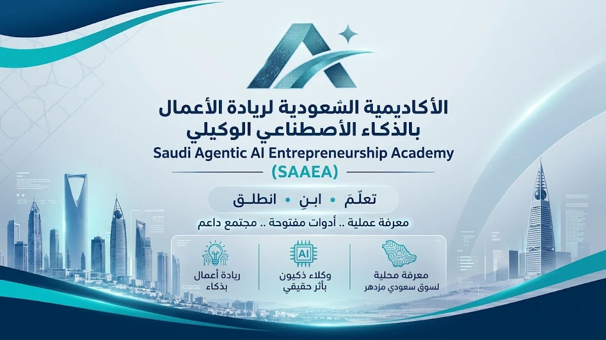
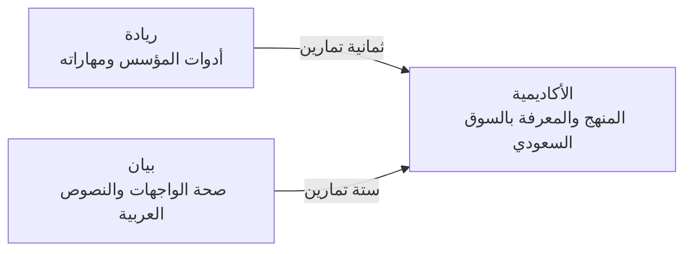

# الأكاديمية السعودية لريادة الأعمال بالذكاء الاصطناعي الوكيلي

**Saudi Agentic AI Entrepreneurship Academy (SAAEA)** · [English](README.en.md)

> تعلّم أن تفكّر كرائد أعمال، وتبني كمهندس ذكاء اصطناعي، وتشغّل منشأتك كشركة قائمة على الوكلاء.

مبادرة معرفية مفتوحة المصدر، عربية أولاً، لكل من يريد تأسيس مشروع في المملكة العربية السعودية يعتمد على الذكاء الاصطناعي الوكيلي (Agentic AI) أو تشغيله أو تنميته. تأخذ المؤسس من مشكلة حقيقية لدى منشأة سعودية إلى وكيل يعمل وعميل يدفع، وتجمع في مسار واحد ريادة الأعمال والهندسة والتشغيل والحوكمة، وتبني محتواها على السياق التنظيمي والاقتصادي للمملكة. أسّسها ويشرف عليها **أ.د. ممدوح العنزي** مبادرةً شخصية مستقلة، وتتطور بمساهمات المجتمع.

**الحالة:** الإصدار 0.8 ([سجل التغييرات](CHANGELOG.md) · [خارطة الطريق](ROADMAP.md) · [جاهزية الإصدار](RELEASE-READINESS.md)) · آخر مراجعة: 20 نوفمبر 2026

| أول زيارة؟ | تريد مشاهدة العروض؟ | تريد المساهمة؟ |
|---|---|---|
| [ابدأ من هنا](START-HERE.md): صفحة واحدة تدلّك على طريقك وتجيب عن الأسئلة الشائعة | [العروض التقديمية في المتصفح](https://malenezi.github.io/saudi-agentic-ai-entrepreneurship-academy/) | [ساهم معنا](#ساهم-معنا): كل مساهمة مرحّب بها، ولا تحتاج إلى Git |

---

## المحتويات

1. [لماذا هذه الأكاديمية](#لماذا-هذه-الأكاديمية)
2. [اختر مسارك](#اختر-مسارك)
3. [ابدأ خلال ساعة](#ابدأ-خلال-ساعة)
4. [المقررات الأربعة](#المقررات-الأربعة)
5. [ما المتاح الآن](#ما-المتاح-الآن)
6. [مستوى الجاهزية](#مستوى-الجاهزية)
7. [المستودعات المرافقة](#المستودعات-المرافقة)
8. [ساهم معنا](#ساهم-معنا)
9. [المبادئ](#المبادئ)
10. [بنية المستودع](#بنية-المستودع)
11. [الترخيص والاستشهاد](#الترخيص-والاستشهاد)
12. [تنبيه](#تنبيه)

---

## لماذا هذه الأكاديمية

- **من الفرصة إلى الإيراد:** مسار يبدأ بمشكلة حقيقية لدى منشأة سعودية وينتهي بوكيل يعمل وعميل يدفع. الغاية تأسيس المشاريع وإطلاق المنتجات وتحقيق الإيرادات، لا التدريب النظري وحده.
- **عربية أولاً:** محتوى ونماذج وأمثلة بالعربية الفصحى واللهجة السعودية، مع المصطلح الإنجليزي حيث يلزم.
- **محلية فعلاً:** الأنظمة والتمويل والقطاعات كما هي في المملكة، ولكل معلومة مصدر وتاريخ مراجعة.
- **أربعة ميادين في مسار واحد:** ريادة الأعمال، والهندسة، والتشغيل، والحوكمة.
- **مقياس النجاح:** فرص جرى التحقق منها ومنتجات أُطلقت، وليس عدد الشهادات.

**لماذا الآن؟** وفق الهيئة العامة للإحصاء، استخدمت 33.1% من المنشآت في المملكة تقنيات الذكاء الاصطناعي في 2025، ارتفاعاً من 27.6% في 2024؛ أي أن نحو ثلثي المنشآت لم تبدأ بعد.

المصدر: «إحصاءات نفاذ واستخدام تقنية المعلومات والاتصالات للمنشآت 2025»، الهيئة العامة للإحصاء، نقلاً عن تغطية صحفية لها؛ البند A1 في [سجل المصادر](SOURCES.md). سنة القياس: 2025.

## اختر مسارك

| أنت | ابدأ بـ | ثم |
|---|---|---|
| رائد أعمال لأول مرة، غير تقني | [قالب سياق المؤسس](04-entrepreneur-toolkit/10-founder-context-template.md) | [المقرر 1](03-courses/01-opportunity/syllabus.md) بالمسار الأساسي |
| صاحب منشأة صغيرة أو متوسطة | [تقييم فرص الوكلاء](04-entrepreneur-toolkit/02-ai-opportunity-assessment.md) على عملياتك | [الوحدة 1.4](03-courses/01-opportunity/lessons/1-4-workflow-shadowing.md)، ثم [قائمة الامتثال للمؤسس](02-saudi-market-knowledge-framework/founder-compliance-checklist.md) |
| مؤسس تقني | [المقرر 1](03-courses/01-opportunity/syllabus.md) مكثفاً | [المقرر 2](03-courses/02-build/syllabus.md) بالمسار العميق |
| طالب أو مستقل | [حقيبة المؤسس](04-entrepreneur-toolkit/README.md) | المقررات بالترتيب، و[دراسات الحالة](06-case-studies/README.md) |
| مدرب، أو جهة تشغّل فوجاً | [دليل المدرب للبرنامج](03-courses/TRAINER-GUIDE.md) | [حقيبة المدرّس لخمسة عشر أسبوعاً](01-academy/instructor-kit/README.md) و[معيار الإتمام](03-courses/assessment-standard.md) |
| تريد معرفة القواعد فقط | [إطار المعرفة بالسوق السعودي](02-saudi-market-knowledge-framework/README.md) | [السجل التنظيمي](02-saudi-market-knowledge-framework/regulatory-register.md) |

المسار الكامل لكل نوع من المتعلمين في [مسارات التعلّم](01-academy/learning-pathways.md)، وللمتعلم الذاتي [دليل المتعلم](03-courses/LEARNER-GUIDE.md).

## ابدأ خلال ساعة

1. املأ [لوحة فكرة المشروع](04-entrepreneur-toolkit/01-startup-idea-canvas.md).
2. راجع [قائمة الامتثال للمؤسس](02-saudi-market-knowledge-framework/founder-compliance-checklist.md) لتعرف ما ينتظرك نظامياً.
3. انسخ [قالب سياق المؤسس](04-entrepreneur-toolkit/10-founder-context-template.md) إلى مساعدك الذكي المفضل.
4. شغّل [المرشد التنظيمي](02-saudi-market-knowledge-framework/founder-agents/README.md) أو إحدى [المهارات الريادية](05-agentic-ai-lab/skills/README.md) على فكرتك.

## المقررات الأربعة

أربعة مقررات متتابعة في 76 ساعة، بمسارين: أساسي منخفض الكود (Low-code)، وعميق لمن يبرمج. ينتهي كل مقرر بمُخرَج تجاري يُقيَّم بالدليل.

| # | المقرر | السؤال | الساعات | المستوى | المُخرَج |
|---|---|---|---|---|---|
| 1 | [اكتشاف الفرصة الوكيلية](03-courses/01-opportunity/syllabus.md) | أي مشكلة؟ | 16 | مبتدئ | أطروحة الفرصة |
| 2 | [بناء الوكلاء الأذكياء](03-courses/02-build/syllabus.md) | هل يعمل؟ | 24 | مبتدئ إلى متوسط | وكيل يعمل ومُقيَّم |
| 3 | [الإطلاق وبناء النموذج التجاري](03-courses/03-launch/syllabus.md) | هل يدفعون؟ | 20 | متوسط | حزمة الإطلاق وتجربة مع عميل |
| 4 | [التوسع والحوكمة](03-courses/04-scale-and-govern/syllabus.md) | هل ينمو بأمان؟ | 16 | متقدم | حزمة التوسع وعرض استثماري |

### حالة كل مقرر

| المقرر | الدروس | العروض | الاختبارات القصيرة | مواد التطبيق | الحالة | ما لم يُختبر بعد |
|---|---|---|---|---|---|---|
| المقرر 1 | 7 | 7 | 7 | موجزات قطاعية، قوالب، سجلات مقابلات، أطروحة نموذجية، سلالم تقدير | **الإصدار الأول من المحتوى متاح** | لم يخضع لتجربة تدريبية فعلية بعد |
| المقرر 2 | 8 | 8 | 8 | قوالب، مثال محلول، سلالم تقدير، و[ثمانية مختبرات](03-courses/02-build/labs/README.md) تعمل دون مفتاح ودون تكلفة | **الإصدار الأول من المحتوى متاح** | لم يخضع لتجربة تدريبية فعلية بعد |
| المقرر 3 | 7 | 7 | 7 | قوالب، مثال محلول، سلالم تقدير | **الإصدار الأول من المحتوى متاح** | لم يخضع لتجربة تدريبية فعلية بعد؛ الوحدتان 3.4 و3.7 لم يراجعهما مختص |
| المقرر 4 | 6 | 6 | 6 | قوالب، مثال محلول، سلالم تقدير | **الإصدار الأول من المحتوى متاح** | لم يخضع لتجربة تدريبية فعلية بعد؛ الوحدتان 4.3 و4.4 لم يراجعهما مختص |

لكل مقرر مسرد ودليل مدرب. والتفاصيل في [فهرس المقررات](03-courses/README.md).

### أدلة البرنامج

| لمن | الدليل |
|---|---|
| المتعلم | [دليل المتعلم](03-courses/LEARNER-GUIDE.md) |
| المدرب | [دليل المدرب للبرنامج](03-courses/TRAINER-GUIDE.md) و[حقيبة 15 أسبوعاً](01-academy/instructor-kit/README.md) |
| المقيّم | [معيار الإتمام](03-courses/assessment-standard.md) و[مصفوفة النواتج والتقييم](03-courses/alignment.md) |
| المراجع المختص، أو جهة تجرّب فوجاً | [حزم المراجعة وبروتوكول التجربة](03-courses/validation/README.md) |

## ما المتاح الآن

| المجال | المخرجات | الجاهزية |
|---|---|---|
| [**إطار المعرفة بالسوق السعودي**](02-saudi-market-knowledge-framework/README.md) | اثنا عشر مجالاً: التأسيس، تنظيم الذكاء الاصطناعي، البيانات، الأمن السيبراني، الضرائب، التمويل، الملكية الفكرية، التجارة الإلكترونية، التوظيف، القطاعات، ذكاء السوق، المشتريات الحكومية. ومعها [سجل تنظيمي](02-saudi-market-knowledge-framework/regulatory-register.md) و[قائمة امتثال](02-saudi-market-knowledge-framework/founder-compliance-checklist.md) و[حقيبة أدوات](02-saudi-market-knowledge-framework/compliance-toolkit/) | **متاح، ويتوسع** |
| [المقررات](03-courses/README.md) | أربعة مقررات: 28 درساً، لكل منها عرض واختبار قصير، مع قوالب وأمثلة محلولة وسلالم تقدير ([التفصيل أعلاه](#حالة-كل-مقرر)) | الإصدار الأول من المحتوى متاح؛ لم يخضع لتجربة تدريبية فعلية بعد |
| [حقيبة المؤسس](04-entrepreneur-toolkit/README.md) | اثنا عشر قالب أعمال ثنائي اللغة، وثلاث حاسبات: تكلفة المهمة، قمع العملاء، تخفيف الملكية | متاح |
| [مختبر الذكاء الاصطناعي الوكيلي](05-agentic-ai-lab/README.md) | اثنتا عشرة [مهارة ريادية](05-agentic-ai-lab/skills/README.md)، خمسة قوالب وكلاء، قالب تقييم، دليل النماذج العربية | متاح |
| [تمارين المختبر](05-agentic-ai-lab/exercises/README.md) | سبعة عشر تمريناً عملياً، منها أربعة عشر تستخدم المستودعين المرافقين | متاح؛ لم تُجرَّب مع متعلمين |
| [دراسات الحالة](06-case-studies/README.md) | تسع حالات حقيقية من مصادر منشورة (ثلاث منها سعودية) بمستويات دليل، وسيناريوهات وورقة عمل؛ واثنا عشر مسار شركة موثّقاً: تمويل، منصات، تخارج، وخمس شركات سعودية تبني للوكلاء | متاح؛ ننتظر حالات يكتبها أصحابها |
| [مسارات التعلّم](01-academy/learning-pathways.md) | مسار لكل نوع من المتعلمين، و[حقيبة مدرّس](01-academy/instructor-kit/README.md) لمقرر من 15 أسبوعاً، و[دفتر المشروع](workbook/index.html) | متاح؛ لم تُجرَّب مع متعلمين |
| [الأكاديمية](01-academy/) | [الرؤية والرسالة](01-academy/vision-and-mission.md)، [الإطار التعليمي](01-academy/learning-framework.md)، [إطار الكفايات](01-academy/competency-framework.md) | متاح |
| [المصادر](07-resources/README.md) · [المجتمع](08-community/README.md) | مراجع مختارة، معرض المشاريع | متاح |

## مستوى الجاهزية

نعرض ما أُنجز كما هو، بلا زيادة. حالة كل بند ونتائج الفحوص في [تقرير جاهزية الإصدار](RELEASE-READINESS.md) و[تقرير مراجعة الجودة](03-courses/QA-REPORT.md).

| متاح للاستخدام | قيد التطوير | لم يُختبر بعد |
|---|---|---|
| المحتوى الأول للمقررات الأربعة | بنود كثيرة في السجل التنظيمي بعلامة ◻ (للتحقق) | لم يُجرَّب أي مقرر مع فوج |
| إطار المعرفة: دليل منشور واحد على الأقل لكل مجال | خمسة أدلة جديدة مبنية على مصادر محدودة: الملكية الفكرية، التجارة الإلكترونية، التوظيف، القطاعات، المشتريات الحكومية | لم يراجع المحتوى التنظيمي محامٍ ولا مستشار ضريبي ولا مختص أمني |
| حقيبة المؤسس، والمختبر، ودراسات الحالة | حالات سعودية يكتبها أصحابها | لم تُجرَّب التمارين ولا دفتر المشروع ولا حقيبة المدرّس مع متعلمين |
| مختبرات المقرر 2 بشيفرة مرجعية مختبَرة | نسخ إنجليزية من الدروس: الدروس عربية بمصطلحات إنجليزية وملخص إنجليزي | معيار الإتمام لم يُطبَّق على فوج |
| فحص آلي للروابط واختبارات عند كل تعديل | وكلاء المؤسس المتبقون وقوالب وكلاء قابلة للتشغيل (الإصدار 0.9) | |

ما يُبنى لاحقاً وترتيبه في [خارطة الطريق](ROADMAP.md).

## المستودعات المرافقة

الأكاديمية واحدة من ثلاثة مستودعات مستقلة لصاحبها نفسه. يعمل كل منها وحده، ويكمل بعضها بعضاً:

| المستودع | عمله | يجيب عن |
|---|---|---|
| **الأكاديمية** (هذا المستودع) | المنهج والمعرفة بالسوق السعودي | ماذا أتعلم، وبأي ترتيب، وما القواعد في المملكة؟ |
| [**ريادة**](https://github.com/malenezi/riyada) | مهارات وملفات سياق وقوالب لمؤسس يبني منشأة ويشغّلها بالوكلاء | كيف أنجز العمل الريادي نفسه مع وكيل؟ |
| [**بيان**](https://github.com/malenezi/bayan) | مهارات ومدققات لواجهات وعروض ونصوص عربية صحيحة | كيف يخرج ما أبنيه بعربية صحيحة اتجاهاً ونصاً؟ |

**نربط ولا ننسخ.** ما يخص المملكة موطنه الأكاديمية، والأدوات الريادية العامة موطنها «ريادة»، وصحة العربية في الواجهات موطنها «بيان». والمستودعان اختياريان: تكتمل المقررات بدونهما. جدول «أيهما أستخدم» وتفاصيل الربط في [المستودعات المرافقة](07-resources/companion-repositories.md).

## ساهم معنا

تُبنى هذه الأكاديمية علناً وعلى مراحل، وهي ملك لمن يساهم فيها. **لا تحتاج أن تكون مبرمجاً ولا خبيراً لتساهم.** تصحيح خطأ إملائي، تحديث رابط، سؤال يكشف نقصاً، تجربة من عملك، ترجمة فقرة، أو دليل كامل: كلها مساهمات نرحّب بها ونشكر صاحبها.

### ثلاث خطوات

**1. اختر مساهمة على قدر وقتك**

| الوقت | المساهمة |
|---|---|
| دقيقة | تصحيح خطأ إملائي أو رابط معطّل |
| 5 دقائق | سؤال أو ملاحظة: «هذا غير واضح» أو «هذا ينقصه كذا» |
| 20 دقيقة | التحقق من بند بعلامة ◻ في [السجل التنظيمي](02-saudi-market-knowledge-framework/regulatory-register.md) |
| ساعة | تجربة من عملك، أو حالات اختبار باللهجة السعودية لوكيل |
| بضع ساعات إلى أسبوع | دليل في أحد المجالات، أو دراسة حالة حقيقية |

لا تعرف من أين تبدأ؟ اختر أي بند عليه علامة ☐ أو ◻ في [إطار المعرفة بالسوق السعودي](02-saudi-market-knowledge-framework/README.md).

**2. أرسلها بالطريقة الأيسر لك**

- **دون Git:** [افتح Issue](https://github.com/malenezi/saudi-agentic-ai-entrepreneurship-academy/issues/new/choose) واكتب ما لديك بأي صيغة، بالعربية أو بالإنجليزية، ونحن نتولى الباقي.
- **تعديل سريع:** افتح الملف في GitHub واضغط زر التعديل، ثم أرسل اقتراحك.
- **طلب دمج (Pull Request):** انسخ المستودع، وعدّل، وشغّل `make check`، ثم افتح الطلب.

**3. نراجعها معك وننسبها إليك**

نستقبل كل مساهمة باحترام ونرد عليها، ونكمل معك ما ينقصها من مصدر أو تنسيق أو ترجمة، ونثبت اسمك في سجل المساهمين إن رغبت. غير متأكد من جودة ما لديك؟ أرسله على أي حال.

### أين الحاجة أشد الآن

- مختص قانوني أو ضريبي أو أمني يراجع إحدى [حزم المراجعة](03-courses/validation/README.md).
- جهة تجرّب مقرراً مع فوج وفق [بروتوكول التجربة](03-courses/validation/pilot-protocol.md).
- التحقق من بنود ◻ في السجل التنظيمي، ومن مدخلات دليل التمويل.
- أدلة يكتبها ممارسون في الضرائب والملكية الفكرية والتوظيف والمشتريات الحكومية.
- دراسات حالة سعودية حقيقية يكتبها أصحابها.

التفاصيل والشروط في [دليل المساهمة](CONTRIBUTING.md) و[ميثاق السلوك](CODE_OF_CONDUCT.md).

## المبادئ

1. **أكاديمية لريادة الأعمال، لا للذكاء الاصطناعي.** الذكاء الاصطناعي وسيلة لتمكين الريادة، وليس غاية في ذاته.
2. **استدلال احتمالي، وصلاحيات حتمية.** يقترح الوكيل وينفّذ ضمن حدود مرسومة، وتبقى القرارات ذات الأثر الجوهري خاضعة لضوابط واضحة وموافقة بشرية صريحة.
3. **لا قيمة للغلاف التقني وحده.** الميزة التنافسية في تصميم سير العمل والبيانات والتكاملات، لا في تغليف نموذج قائم.
4. **تحقّق قبل أن تبيع.** أثبت الحاجة والجدوى والقيمة قبل أن تطوّر الحل وتسوّقه.
5. **لا رقم بلا مصدر.** ولا يُعرض نظام أو تشريع أو متطلب تنظيمي على أنه سارٍ قبل التحقق من حداثته ونفاذه.
6. **المعرفة مفتوحة للجميع.** نرحّب بكل مساهمة وفكرة، ونستقبلها باحترام وتقدير.

## بنية المستودع

| المسار | المحتوى |
|---|---|
| [`01-academy/`](01-academy/) | الرؤية والرسالة، الإطار التعليمي، إطار الكفايات، مسارات التعلّم، حقيبة المدرّس |
| [`02-saudi-market-knowledge-framework/`](02-saudi-market-knowledge-framework/README.md) | المجالات الاثنا عشر، السجل التنظيمي، [دليل الجهات الرسمية](02-saudi-market-knowledge-framework/official-directory.md)، حقيبة الامتثال، وكلاء المؤسس |
| [`03-courses/`](03-courses/README.md) | المقررات الأربعة وأدلتها ومعيار الإتمام وملفات التحقق |
| [`04-entrepreneur-toolkit/`](04-entrepreneur-toolkit/README.md) | قوالب المؤسس وحاسباته |
| [`05-agentic-ai-lab/`](05-agentic-ai-lab/README.md) | المهارات، قوالب الوكلاء، التقييم، التمارين |
| [`06-case-studies/`](06-case-studies/README.md) | دراسات الحالة ومسارات الشركات |
| [`07-resources/`](07-resources/README.md) | المراجع، والمستودعات المرافقة |
| [`08-community/`](08-community/README.md) | المشاركة ومعرض المشاريع |
| [`workbook/`](workbook/index.html) | دفتر المشروع |
| `tools/` · `tests/` | أدوات البناء والفحص واختباراتها؛ تُشغَّل كلها بالأمر `make check` |
| [`SOURCES.md`](SOURCES.md) | سجل المصادر: كل معلومة خارجية بمصدرها وتاريخ التحقق منها |

## الترخيص والاستشهاد

- المحتوى التعليمي: [CC BY 4.0](LICENSE-CONTENT.md)
- الشيفرة البرمجية: [Apache-2.0](LICENSE)
- مواد الأطراف الأخرى: [THIRD-PARTY.md](THIRD-PARTY.md)
- للاستشهاد بالأكاديمية: [CITATION.cff](CITATION.cff) · للإبلاغ عن مسألة أمنية: [SECURITY.md](SECURITY.md)

## تنبيه

مبادرة شخصية مستقلة، لا تمثل أي جهة حكومية أو خاصة ولا تحمل اعتمادها. المحتوى التنظيمي للتوعية وليس استشارة قانونية أو ضريبية؛ ارجع دائماً إلى النص الرسمي والجهة المختصة.

